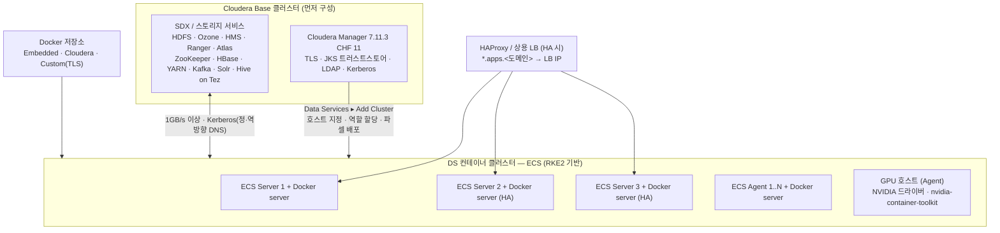
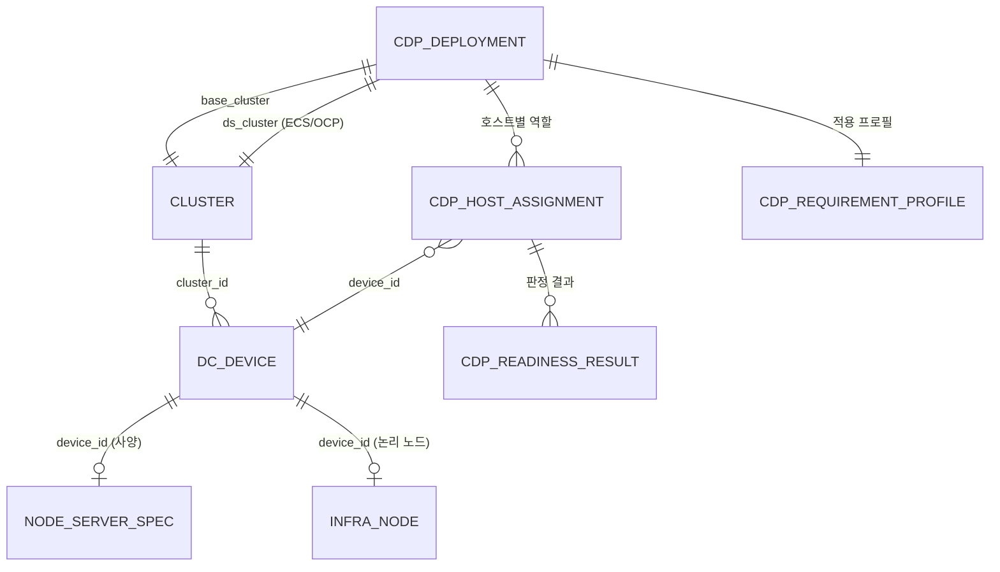

# Cloudera Data Services 1.5.4 호스트 아키텍처 — 정리와 PEP 반영 설계 (계획 · 목업)

> 상태: **설계만** (2026-11-23). 코드 변경 없음. 수치와 규칙은 모두 Cloudera 1.5.4 원문(§9 출처)에서 옮겼다.
> 원문에서 확인하지 못한 항목은 **원문 미확인**으로 표시했다.

## 1. 개요

### 1-1. 목적

- Cloudera Data Services(이하 DS) on premises 1.5.4 설치 문서에서 **호스트(host)** 에 관한 요구사항을 한곳에 모은다.
  호스트 역할, 대수, 사양, OS, 스토리지, 네트워크, DNS 가 대상이다.
- PEP 가 이 요구사항을 **설치 전 호스트 준비도 점검**과 **운영 중 편차 감시**로 다루는 방법을 설계한다.
  기존 자산(DC 인벤토리 · 노드 서버 스펙 · 점검 매트릭스 · 노드 파라미터 감시)을 재사용한다.

### 1-2. 한 장 요약

| 구분 | 내용 |
|---|---|
| 구성 | **Base 클러스터**(Cloudera Manager + SDX/스토리지)가 먼저 있고, 그 CM 에서 **DS 컨테이너 클러스터**(ECS 또는 OpenShift)를 추가한다 |
| ECS 호스트 역할 | ECS Server(+Docker server) · ECS Agent(+Docker server). 단일 노드는 CDSW→CML 이전 용도로만 지원 |
| ECS HA | 설치 후에 켠다. Server 3대 이상(1대 장애 허용), 5대 이상(2대 장애 허용). 2대 구성은 전환 중에만 허용. 호스트 5대에서 검증, **6대 이상 권장** |
| Control Plane 최소 | 1노드(Non-HA) / 3노드(HA) · 16코어 · 32GB · 300GB (권장 32코어 · 64GB · 1TB, 노드당) |
| 공통 디스크 | `/var/lib` 300GiB 이상 여유, docker 디렉터리(기본 `/docker`) 300GiB 이상 여유, `/var/lib/longhorn` 심볼릭 링크 금지 |
| OS | ECS: RHEL 8.7–8.10 · 9.1–9.4, OEL(RHCK 커널만) 8.7–8.9 · 9.1–9.3. RHEL 7.x 는 1.5.4 부터 미지원 |
| 네트워크 | 이더넷 인터페이스 1개(멀티호밍 미지원), 와일드카드 DNS `*.apps.<도메인>`, 정·역방향 DNS, NTP 동기, docker 기본 대역 `172.17.0.0/16` 충돌 금지 |
| PEP 반영 | DS 호스트 프로필(요구사항 값 = 화면 편집) → 호스트별 준비도 판정 → 점검 매트릭스 deep check 로 정기 재점검 |

---

## 2. 호스트 아키텍처

### 2-1. 전체 구성



- DS 는 Base 클러스터 없이 설치할 수 없다. "Base 클러스터를 먼저 구성한 뒤 컨테이너 클러스터를 설치한다"가 원문 규칙이다.
- ECS 는 별도 호스트로 구성하거나 **Base 노드를 DS 용도로 전환**(Repurposing)할 수 있다. 전환 절차는 원문 별도 문서다.
- OpenShift 배포는 ECS 대신 **전용 OCP 클러스터**(단일 테넌트, 타사 앱 공존 금지)를 쓴다. 호스트 역할이 다르다(§3-3).

### 2-2. ECS 호스트 역할

| 역할 | 구성 요소 | 대수 | 비고 |
|---|---|---|---|
| ECS Server | RKE2 server, etcd, Docker server | 1(기본) → 3 이상(HA) | 2대는 3대로 가는 전환 중에만 허용. 1대 장애 허용 = 3대 이상, 2대 장애 허용 = 5대 이상 |
| ECS Agent | RKE2 agent, Docker server | 1 이상(필수) | 한 번에 추가하는 Agent 는 50대 미만. 50대가 넘는 클러스터는 50대 미만으로 설치한 뒤 늘린다 |
| GPU 호스트 | Agent + NVIDIA 스택 | 선택 | `nvidia-smi` 정상, nvidia-container-toolkit 설치. OS 는 RHEL 만(8.7–8.10, 9.1–9.4) |
| Load Balancer | HAProxy(keepalived) 또는 상용 LB | HA 시 1(+이중화) | TCP 모드 · 라운드 로빈 · HTTPS 패스스루 |
| 단일 노드 | Docker + ECS Server 만 | 1 | CDSW → Cloudera AI 이전 전용 |

- 역할 할당은 CM 의 **Assign Roles** 단계에서 정한다. 원문은 특별한 사유가 없으면 기본 할당을 바꾸지 말라고 권한다.
- Longhorn 복제 수는 기본 2이고 **설치할 때만** 정할 수 있다. 3 이상은 성능 저하 가능성이 있다.
- `kubectl delete node` 를 실행하면 호스트가 영구 제거되고 데이터가 사라진다. 재투입하려면 호스트를 재포맷해야 한다.

### 2-3. HA DNS 레코드 구성 (원문 예시)

| 호스트명 | 서브도메인 | 역할 | 정방향 | 역방향 PTR |
|---|---|---|---|---|
| `*` | `apps.ecs.example.com` (`apps` 필수, `ecs` 는 임의) | 가상 앱 도메인 와일드카드 | A 와일드카드 → LB IP(또는 VIP) | N |
| apps 별칭 | `apps.ecs.example.com` | 가상 앱 도메인 별칭 | CNAME → LB A 레코드(또는 LB IP A 레코드) | N/A |
| LB | LB 도메인 | HA 로드밸런서 | 벤더별 | — |
| `ecs-master1..3` | `example.com` | ECS Server + Docker server | A → 각 IP | Y |
| `ecs-agentN` | `example.com` | ECS Agent + Docker server | A → 각 IP | Y |

- 모든 Base · ECS 호스트에서 정·역방향 조회가 돼야 한다. `/etc/hosts` 항목은 쓰지 않는다.
- 와일드카드 레코드가 준비되기 전에는 HA 설정을 진행할 수 없다.

---

## 3. 호스트별 사양

### 3-1. ECS — Control Plane (HA / Non-HA)

| 항목 | 최소 | 권장(노드당) |
|---|---|---|
| 노드 수 | 1 (Non-HA) | 3 (HA) |
| CPU | 16코어 | 32코어 |
| 메모리 | 32GB | 64GB |
| 스토리지 | 300GB | 1TB |
| 네트워크 | 모든 노드 · Base 클러스터까지 1GB/s | 1GB/s |

전체 소요량은 **Control Plane 사양 + 사용할 데이터 서비스별 추가 사양**의 합이다. 원문은 사이징 스프레드시트로
호스트 수와 사양을 모델링하라고 안내한다.

### 3-2. 데이터 서비스별 추가 사양 (ECS · Standard resource mode)

| 서비스 | 노드 수 | CPU | 메모리 | 스토리지 | 네트워크 |
|---|---|---|---|---|---|
| Data Warehouse (CDW) | 최소 4 / 권장 10 | 워커당 16코어(SMT 시 8코어·16스레드) / 32코어 이상 | 워커당 128GB / 384GB | 워커마다 로컬 SCSI(FAST 캐시) 1.2TB SATA·SSD / 1.2TB NVMe·SSD. ECS 는 Local Path Provisioner | 1GB/s / 10GB/s |
| Data Engineering (CDE) | 최소 2 / 권장 4 (원문 권장: 마스터 1 + 워커 2) | 워크스페이스 16코어 + 워크로드 8코어 / + 32코어 | 워크스페이스 64GB + 워크로드 32GB / + 64GB | 블록 200GB + NFS 500GB | 1GB/s / 10GB/s |
| Cloudera AI (CML) | 최소 1 / 워크벤치당 1 + 워크로드분 | 워크벤치당 32코어 / 48코어 (+ 워크로드) | 128GB / 워크벤치당 256GB (+ 워크로드) | SSD 기반 Longhorn 블록 누적 2600GB 권장. 운영은 외부 NFS 1000GB 이상 권장 | 1GB/s |

- **CDW 증설 단위**: 메모리 128GB, 로컬 SSD/NVMe 600GB 단위로 늘린다. 단위를 넘는 몫은 executor 파드가 쓰지 못한다.
  예) 노드당 executor 3개 = 메모리 384GB + 로컬 디스크 약 1.8TB.
- **CML 스토리지 총량**(노드당이 아님, DRS 없음): 외부 NFS 1300Gi / 내부 NFS 3300Gi(워크벤치당).
  DRS 백업 1회를 포함하면 2600Gi / 6600Gi.
- **CML 워크로드 추가분**: 동시 워크로드당 1코어 · 2GB(최소), 2–16코어 · 4–64GB(권장).
- **CDE 서비스 고정 소요**: 7 vCPU · 15GB · 110GB 블록/NFS PV. **가상 클러스터당**(Spark 3): 5.35 vCPU · 15.6GB · 400GB.
  Spark 2 는 0.5 vCPU · 4.5GB · 100GB 를 더한다.
- **CDE GPU**: Spark RAPIDS 검증 GPU 는 P100 · V100 · T4 · A2/A10/A30/A100 이다.

### 3-3. OpenShift 배포의 호스트 역할

| 역할 | CPU | 메모리 | 스토리지(SSD 만) | 대수 |
|---|---|---|---|---|
| Master | 4코어 | 16GB | 120GB | 3 이상 |
| CSAH (Cluster System Admin Host) | 4코어 | 64GB | 200GB | 1 |
| Bootstrap | 4코어 | 16GB | 120GB | 1 (설치 후 워커로 전환 가능) |
| Worker | 워크로드에 따름 | — | — | 최소 10 / 권장 20 (기본 설치 가이드) |

OCP 워커 가이드라인: CPU 16 / 32 이상, 메모리 128GB / 384GB, 스토리지 2TB SATA / 4TB SSD·NVMe,
Base 노드마다 전용 대역폭 1Gbps / 10Gbps(최소 / 권장).

### 3-4. 데이터 서비스별 스토리지 유형 (OpenShift 문서 기준)

| 서비스 | 유형 | 용량 | 용도 |
|---|---|---|---|
| Control Plane | 블록 | 외부 DB 118GB / 내장 DB 318GB (SSD) | Fluentd · Prometheus · Vault · 내장 DB |
| CDE | 블록(RWO) | 서비스당 110GB | 서비스 · 가상 클러스터 DB |
| CDE | 파일/NFS(RWX) | 가상 클러스터당 400GB | 아티팩트 · Airflow DAG · 로그 |
| CDW | 로컬 | executor 당 LITE 100GB / FULL 600GB | 캐시 |
| CML | 블록 | 노드당 600GB(최소) / 4.5TB(권장) | 워크벤치 정보 |
| CML | 외부 NFS 또는 블록 | 워크벤치당 1TB | 사용자 프로젝트 파일 |
| MonitoringApp | 블록 | 30GB + 환경 수 × 100GB | Prometheus 지표 |
| Data Catalog | CP DB | +100GB | 프로파일링 메타데이터 |

ECS 에서도 같은 용량을 Longhorn(블록) · Local Path(로컬) · 내장/외부 NFS 로 받는다.
유형별 ECS 매핑 표는 **원문 미확인**이다(위 표는 OpenShift 문서다).

---

## 4. OS · 소프트웨어 요구사항 (ECS 호스트)

| 항목 | 요구사항 |
|---|---|
| OS | RHEL 8.7 · 8.8 · 8.9 · 8.10 · 9.1 · 9.2 · 9.3 · 9.4 / OEL(RHCK 커널만) 8.7 · 8.8 · 8.9 · 9.1 · 9.2 · 9.3 |
| RHEL 7.x | 1.5.4 부터 미지원(먼저 업그레이드) |
| Cloudera Manager | 7.11.3 CHF 11 동봉. 이전 CM 은 먼저 업그레이드 |
| Python | 3.8 필수(없으면 CM 에이전트가 기동하지 않음) |
| Java | 모든 ECS 호스트에 설치되고 버전이 같아야 함(VersionInspection) |
| nfs-utils | Cloudera AI 를 쓰면 모든 ECS 노드에 필요(longhorn-nfs 마운트) |
| GPU | NVIDIA 드라이버 + nvidia-container-toolkit, `nvidia-smi` 정상 |
| iptables | 명령이 있으면 규칙이 비어 있어야 함. 없으면 설치 중 자동 설치. HA 로 추가하는 마스터에는 직접 설치 |
| RHEL 8/9 | `nm-cloud-setup.service` · `.timer` 비활성화 후 재부팅 |
| 이미지 서버 | podman 서비스 사용 금지 |
| 인증 | Kerberos(AD · FreeIPA), CM TLS(AutoTLS), JKS 트러스트스토어(PKCS12 아님), LDAP(AD · OpenLDAP) |
| ACL | `/var/lib/rancher` `/etc/rancher` `/var/log/rancher` `/var/lib/kubelet` `/etc/kubernetes` `/var/lib/etcd` `/var/log/pods` `/var/run/secrets/kubernetes.io` 의 ACL 변경 금지 |

### 4-1. 설치 마법사의 호스트 사전 점검 (CM Check Prerequisites)

| 점검 | 내용 |
|---|---|
| StorageInspection | `/var/lib` 와 docker 데이터 디렉터리 각각 300GiB 이상. `/var/lib/longhorn` 또는 상위 경로가 심볼릭 링크면 실패 |
| CPUInspection | 가상 코어 16개 이상 |
| PortsInspection | 443 · 80 사용 가능 |
| EcsHostDnsInspection | `/etc/resolv.conf` nameserver 3개 미만, CM · CDP 콘솔 연결, `vault.localhost.localdomain` 조회. `/etc/nsswitch.conf` hosts 에 `myhostname` |
| VersionInspection | Java 설치 · 버전 일치 |
| IPTablesInspection | iptables 규칙 비어 있음 |
| EcsCleanUpHostInspection | `/var/lib/rancher` · docker 데이터 디렉터리가 비어 있음 |

이어서 **Inspect Hosts / Inspect Network Performance** 로 더 넓은 호스트 · 네트워크 검사를 한다.

---

## 5. 네트워크 · 포트 · DNS

### 5-1. 포트

| 대상 | 프로토콜 | 포트 |
|---|---|---|
| Docker 저장소 · Agent (저장소 방식과 무관) | TCP | 7180–7192, 19001, 5000(Cloudera AI), 9000 |
| ECS Server 인바운드 (RKE2) | TCP | 9345, 6443, 10250, 2379, 2380, 2381, 30000–32767 |
| ECS Server 인바운드 (RKE2) | UDP | 8472 |
| ECS Agent 인바운드 (RKE2) | UDP | 4789 |
| 모든 ECS 호스트 | TCP | 80, 443 (PortsInspection) |

### 5-2. 네트워크 · DNS 규칙

- 이더넷 인터페이스는 1개만 쓴다. 멀티호밍은 지원하지 않는다.
- Base ↔ ECS 호스트 간 정·역방향 DNS 가 필요하다(Kerberos TGT 발급용).
- 앱 도메인 와일드카드 `*.apps.<도메인>` A 레코드가 필요하다. 기본값은 CM 이 클러스터 호스트 하나를 가리키므로, 설치 중 확인하고 필요하면 바꾼다.
- Base 와 ECS 의 NTP 시각이 일치해야 한다. 인터넷이 없는 환경에서 특히 중요하다.
- docker 기본 서브넷 `172.17.0.0/16` 을 다른 서비스가 쓰면 안 된다(필요하면 다른 대역 지정).
- Cluster IP Range(`cluster-cidr`) · Service IP Range(`service-cidr`) 는 **배포 후 바꿀 수 없다**. 잘못 정하면 클러스터를 해체하고 다시 배포해야 한다.
- 스파인-리프 오버서브스크립션은 4:1 이하를 권장한다.

### 5-3. Docker 저장소

| 방식 | 특징 |
|---|---|
| Embedded | 설치 중 Docker 데몬이 저장소 역할. 단일 장애점이고 다른 노드로 옮기려면 Cloudera 전문 서비스가 필요. 복사 1–2시간 |
| Cloudera | 인터넷 연결 필요. 가장 빠르며 PoC · 비운영용 |
| Custom | 직접 운영하는 저장소. **TLS 필수**, 복사 4–5시간. 비밀번호에 `$` 금지 |

---

## 6. 스토리지 경로 규칙 (ECS)

| 경로 | 규칙 |
|---|---|
| `/var/lib` | 설치 시점 여유 300GiB 이상 |
| docker 데이터 디렉터리 | 기본 `/docker`, 다른 경로 지정 가능(예: `/ecs/docker`). 여유 300GiB 이상, 설치 전에 미리 만든다 |
| `/var/lib/longhorn` | 자신과 상위 경로 모두 심볼릭 링크 금지 |
| Local Path Storage Directory | HDD · SSD 가 섞여 있으면 최적 디스크(SSD/NVMe) 경로를 지정 |
| `/var/lib/rancher` | 설치 전 비어 있어야 함 |
| 인그레스 인증서 | PEM 인증서 · 비암호화 키, 앞뒤 설명 텍스트 금지, `cloudera-scm` 이 읽을 수 있어야 함 |

---

## 7. 정보 아키텍처 (엔터티 모델)

DS 호스트 정보를 PEP 에 담을 때의 개념 모델이다. 물리 신원은 기존 **`dc_devices` 단일 원본**을 그대로 쓰고,
DS 고유 정보만 덧붙인다.



| 엔터티 | 역할 | 비고 |
|---|---|---|
| `CDP_DEPLOYMENT` | Base 클러스터와 DS 클러스터의 짝, 플랫폼(ECS/OCP), 버전(1.5.4), 앱 도메인, CIDR, Docker 저장소 방식, Longhorn 복제 수 | 1 배포 = 1행 |
| `CDP_HOST_ASSIGNMENT` | 호스트 ↔ 역할(ECS Server / Agent / GPU / LB / OCP Master · CSAH · Bootstrap · Worker) · 배치 서비스(CDW/CDE/CML) | 호스트 신원은 `dc_devices` 참조 |
| `CDP_REQUIREMENT_PROFILE` | §3–§6 의 요구값(역할별 CPU · 메모리 · 디스크 · OS 목록 · 포트 · 경로) | **DB 행 = 화면 편집**. 1.5.4 기본 프로필을 시드로 넣는다 |
| `CDP_READINESS_RESULT` | 호스트 × 항목 판정(통과 · 경고 · 실패 · 미확인)과 근거 값 | 로그성, 최신만 화면 노출 |

> 엔터티 이름은 개념 이름이다. 실제 테이블 이름 · 컬럼은 구현 단계에서 `backend-feature` 스킬 절차로 정한다.

---

## 8. PEP 반영 설계

### 8-1. 원칙

- **UI-First**: 요구값(16코어, 300GiB, OS 목록, 포트 등)을 코드에 박지 않는다. 요구사항 프로필 행에 두고 화면에서 고친다.
  버전이 바뀌면(1.5.5 등) 프로필을 복제해 값만 고친다.
- **분석과 조치 분리**: PEP 는 판정만 한다. 디스크 정리 · 패키지 설치 같은 조치는 자동으로 실행하지 않는다.
- **자격증명 미저장**: SSH 로 수집할 때는 기존 흐름(요청 시에만 사용)을 따르고 스냅샷만 남긴다.
- **Fail-safe**: 수집하지 못한 항목은 "통과"가 아니라 **미확인**으로 판정한다.

### 8-2. 기존 자산 재사용

| 요구사항 | 값의 출처(기존) | 재사용 방법 |
|---|---|---|
| CPU 코어 · 메모리 · 디스크 · GPU 모델 | `node_server_specs` (`cpu_cores`·`cpu_threads`·`memory_gb`·`non_os_disk_gb`·`disk_type`·`gpu_model`) | 역할별 최소 · 권장값과 대조 |
| 호스트 신원 · 랙 · 클러스터 소속 | `dc_devices` (`hostname`·`rack_id`·`cluster_id`) | 배포 대상 호스트 선택 목록 |
| 인터페이스 수(멀티호밍) | `node_server_specs` bond 정보 · DC 인벤토리 인터페이스 | 서비스 IP 가 붙은 인터페이스가 1개인지 확인 |
| OS 버전 · 커널 · 파라미터 | `node_param_watch` 에이전트 보고 · `config_snapshot` | OS 허용 목록과 대조, `nm-cloud-setup` 상태 |
| `/var/lib` · docker 경로 여유 · 심볼릭 링크 · 빈 디렉터리 | 신규 deep check (SSH/에이전트 수집) | `registered_checks/` 에 체커 추가 |
| 포트 · DNS · NTP · resolv.conf | 신규 deep check | 기존 `custom_kubectl`·`coredns_health` 체커 구조를 참고 |
| 정기 재점검 | 점검 매트릭스 cron | 설치 후에도 편차 감시(디스크 여유 감소, OS 패치 등) |

### 8-3. 신규 점검 항목 (deep check 후보)

| 체커 | 판정 | params / thresholds (화면 편집) |
|---|---|---|
| `cdp_host_capacity` | 역할별 CPU · 메모리 · 디스크 최소 · 권장 충족 | 프로필 ID, 역할 매핑 |
| `cdp_host_storage_paths` | `/var/lib` · docker 경로 여유, longhorn 심볼릭 링크, rancher · docker 디렉터리 비어 있음 | `docker_dir`(기본 `/docker`), `min_free_gib`(300) |
| `cdp_host_os` | OS · 버전 허용 목록, Python 3.8, Java 일치, nfs-utils, iptables 규칙, `nm-cloud-setup` 비활성 | `allowed_os`, `require_nfs_utils` |
| `cdp_host_network` | 정·역방향 DNS, 와일드카드 조회, nameserver 3개 미만, `myhostname`, NTP 오차, `172.17.0.0/16` 충돌, 인터페이스 1개 | `app_domain`, `ntp_max_offset_ms`, `docker_subnet` |
| `cdp_host_ports` | 역할별 포트 개방 · 미사용(설치 전 80/443 비어 있음) | 역할별 포트 목록 |
| `cdp_gpu_host` | `nvidia-smi` 정상, nvidia-container-toolkit, RHEL 여부 | 대상 호스트 셀렉터 |

- 새 체커를 넣을 때는 `services/check_matrix_runbook.py` 의 명령 목록을 같은 커밋에서 갱신한다(가시화 규칙).
- `param_fields` · `threshold_fields` 에 `label` · `help` 를 채운다.

### 8-4. 화면 배치

- 새 화면 **CDP 호스트 준비도** (`/cdp-hosts`, 인프라 그룹). per-cluster 화면이므로 `ClusterSidebar iconOnly` 를 쓴다.
  선택 대상은 **DS 클러스터**다.
- 탭: **구성** (배포 정보 · 역할 할당) / **준비도** (호스트 × 항목 판정) / **요구사항 프로필** (편집).
- 준비도 실행은 실행형 화면이므로 **로그 중심 패턴**(`DESIGN_SYSTEM.md` §12.6.1)을 따른다.
  `RunLogPanel` 로 상세 실시간 로그를 표시하고, 사용자가 로그 보기 옵션(펼침 · 접힘, 실패만)을 고를 수 있게 한다
  (CLAUDE.md 사용자 요청 규칙).
- viewer 에게는 실행 · 저장 버튼을 숨기지 않고 `useCanOperate()` + 사유로 비활성화한다.

---

### 8-5. 목업

> 화면 목업은 구조만 나타낸 와이어프레임이다. 색은 테마 토큰을 쓰고, 정상은 중립색, 비정상만 상태색으로 표시한다.

### 목업 1 — 구성 탭

```
┌──┬───────────────────────────────────────────────────────────────────────────────┐
│◉ │ CDP 호스트 준비도                                          [구성] 준비도  프로필 │
│◯ ├───────────────────────────────────────────────────────────────────────────────┤
│◯ │ ┌ 배포 정보 ──────────────────────────────────────────────────── [편집] ┐      │
│  │ │ Base 클러스터   cdp-base-prod          플랫폼   ECS (RKE2) · 1.5.4      │      │
│  │ │ 앱 도메인       *.apps.ecs.corp.local  Docker  Custom (TLS)            │      │
│  │ │ cluster-cidr    10.42.0.0/16 (변경 불가)  service-cidr 10.43.0.0/16      │      │
│  │ │ Longhorn 복제   2 (설치 시에만 지정)      ECS HA   켜짐 · Server 3대     │      │
│  │ └─────────────────────────────────────────────────────────────────────┘      │
│  │ ┌ 역할 할당 ─────────────────────────────── [호스트 추가] [DC 인벤토리에서] ┐ │
│  │ │ 호스트            역할          서비스     랙 / U     CPU  메모리  디스크   │ │
│  │ │ ecs-master1      ECS Server    CP         R01 / 20   32   64GB   1TB      │ │
│  │ │ ecs-master2      ECS Server    CP         R02 / 20   32   64GB   1TB      │ │
│  │ │ ecs-master3      ECS Server    CP         R03 / 20   32   64GB   1TB      │ │
│  │ │ ecs-agent01      ECS Agent     CDW        R01 / 18   32   384GB  1.8TB    │ │
│  │ │ ecs-agent05      ECS Agent·GPU CML        R04 / 10   48   256GB  2.6TB    │ │
│  │ │ lb01             Load Balancer —          R01 / 40   —    —      —        │ │
│  │ └─────────────────────────────────────────────────────────────────────┘ │
│  │  안내: ECS Server 2대 구성은 전환 중에만 허용 · Agent 는 한 번에 50대 미만 추가   │
└──┴───────────────────────────────────────────────────────────────────────────────┘
```

### 목업 2 — 준비도 탭 (로그 중심 패턴)

```
┌──┬──────────────────────┬────────────────────────────────────────────────────────┐
│◉ │ 대상                 │ 실행 로그                          로그 보기 [전체 ▾]   │
│◯ │ ☑ 전체 호스트 (6)     │ ┌──────────────────────────────────────────────────┐ │
│◯ │ ☐ 역할별 선택        │ │ 10:02:11 ecs-master1 StorageInspection /var/lib   │ │
│  │                      │ │          여유 412GiB ≥ 300GiB ... 통과            │ │
│  │ 점검 항목            │ │ 10:02:12 ecs-agent01 docker_dir=/ecs/docker       │ │
│  │ ☑ 용량(CPU·메모리)   │ │          여유 188GiB < 300GiB ... 실패            │ │
│  │ ☑ 스토리지 경로      │ │ 10:02:13 ecs-agent05 nvidia-smi ... 통과          │ │
│  │ ☑ OS·패키지          │ │ 10:02:14 lb01 SSH 수집 실패 ... 미확인            │ │
│  │ ☑ 네트워크·DNS       │ └──────────────────────────────────────────────────┘ │
│  │ ☑ 포트               │ 결과 (호스트 × 항목)              [실패만] [CSV]       │
│  │ ☐ GPU                │ 호스트        용량  스토리지  OS   네트워크  포트  GPU  │
│  │                      │ ecs-master1   통과  통과     통과  통과     통과  —    │
│  │ 프로필 CDP DS 1.5.4  │ ecs-agent01   권장↓ 실패     통과  통과     통과  —    │
│  │                      │ ecs-agent05   통과  통과     통과  경고     통과  통과 │
│  │                      │ lb01          미확인 미확인  미확인 통과    통과  —    │
│  ├──────────────────────┤                                                        │
│  │ [  준비도 점검 실행  ] │ 셀 클릭 → 근거 값 · 요구값 · 원문 링크 패널            │
└──┴──────────────────────┴────────────────────────────────────────────────────────┘
```

- 좌측 제어 영역은 320px 이하이고 실행 바는 하단에 고정한다. 판정은 조회만 하므로 확인 대화상자 없이 실행한다.
- 결과 셀: 통과 = 중립색, 권장 미달 = 경고색, 실패 = 위험색, 미확인 = 흐린 중립색 + 사유.

### 목업 3 — 요구사항 프로필 탭

```
┌──┬───────────────────────────────────────────────────────────────────────────────┐
│◉ │ 프로필  [CDP DS 1.5.4 (기본) ▾]                       [복제] [저장] (operate) │
│◯ ├───────────────────────────────────────────────────────────────────────────────┤
│  │ 역할 사양                                                                     │
│  │ 역할          서비스  CPU 최소/권장   메모리 최소/권장   디스크 최소/권장  출처 │
│  │ Control Plane —       16 / 32        32 / 64 GB         300 GB / 1 TB   [원문]│
│  │ Worker        CDW     16 / 32        128 / 384 GB       1.2 TB 로컬 SSD [원문]│
│  │ Worker        CDE     24 / 48        96 / 128 GB        200 GB+NFS 500  [원문]│
│  │ Worker        CML     32 / 48        128 / 256 GB       2600 GB 블록    [원문]│
│  │ 공통 경로                                                                     │
│  │ /var/lib 여유 ≥ [300] GiB   docker 경로 [/docker]  여유 ≥ [300] GiB           │
│  │ 허용 OS  [RHEL 8.7–8.10, 9.1–9.4] [OEL(RHCK) 8.7–8.9, 9.1–9.3]   [+ 추가]   │
│  │ 포트     Server TCP [9345, 6443, 10250, 2379–2381, 30000–32767] UDP [8472]   │
│  │          Agent  UDP [4789]   저장소 TCP [7180–7192, 19001, 5000, 9000]        │
│  │ 네트워크 인터페이스 [1]개  docker 대역 [172.17.0.0/16]  NTP 오차 ≤ [500] ms    │
└──┴───────────────────────────────────────────────────────────────────────────────┘
```

- 실제 화면의 출처 링크는 `title` · `aria-label` 이 있는 아이콘 버튼이다. 이모지 문자 아이콘은 쓰지 않는다.
- CDE 의 CPU · 메모리는 워크스페이스와 워크로드 값을 더한 수치다. 예) 16 + 8 = 24 코어, 64 + 32 = 96GB.
- NTP 허용 오차(500ms)는 PEP 기본값 제안이다. 원문에는 수치가 없다(**원문 미확인**).

### 8-6. 단계별 구현 계획 (단계마다 PR 1개)

| 단계 | 범위 | 완료 기준 |
|---|---|---|
| 1 | 본 설계 문서 | 사용자 검토 · 확정 |
| 2 | 모델(배포 · 역할 할당 · 프로필 · 결과) + `_safe_*` 마이그레이션 + 1.5.4 프로필 시드 + CRUD API + 백업 호환 | pytest, 백업 export/import 왕복 |
| 3 | 용량 판정(기존 `node_server_specs` 대조만, 수집 없음) + 화면 구성 · 프로필 탭 | lint · tsc · build, 문서 동기화 |
| 4 | deep check 6종 + 런북 명령 목록 + 점검 매트릭스 등록 | 런북 커버리지 테스트 |
| 5 | 준비도 탭(RunLogPanel 실시간 로그, 결과 표, 근거 패널) | 화면 확인, a11y 스캔 |
| 6 | (선택) 사이징 계산기: 서비스 · 워크벤치 · executor 수 입력 → 필요 호스트 수 | 원문 예시와 계산 일치 |

### 8-7. 결정할 사항

| 항목 | 선택지 | 제안 |
|---|---|---|
| OpenShift 지원 범위 | ECS 만 / ECS + OCP | 1차는 ECS 만, 프로필 구조는 OCP 역할도 담을 수 있게 |
| 수집 경로 | SSH 일회 수집 / 노드 파라미터 에이전트 | 설치 전 = SSH(에이전트 없음), 설치 후 = 에이전트 |
| 화면 위치 | 신규 `/cdp-hosts` / DC 인벤토리 하위 탭 | 신규 화면(클러스터 단위 운영 화면) |
| Base 노드 전환(Repurposing) | 포함 / 제외 | 1차 제외. 전환 절차 문서를 확인한 뒤 별도 설계 |

---

## 9. 출처 (Cloudera 1.5.4, 2026-11-23 확인)

| 내용 | URL |
|---|---|
| 1.5.4 문서 루트 | https://docs.cloudera.com/cdp-private-cloud-data-services/1.5.4/ |
| ECS 요구사항 목차 | https://docs.cloudera.com/cdp-private-cloud-data-services/1.5.4/installation-ecs/topics/cdppvc-requirements-ecs.html |
| 하드웨어 요구사항(합산 규칙) | https://docs.cloudera.com/cdp-private-cloud-data-services/1.5.4/installation-ecs/topics/cdppvc-installation-ecs-hardware-requirements.html |
| Control Plane HA / Non-HA | https://docs.cloudera.com/cdp-private-cloud-data-services/1.5.4/installation-ecs/topics/cdppvc-installation-standalone-hanha-requirements.html |
| CDW 추가 사양 | https://docs.cloudera.com/cdp-private-cloud-data-services/1.5.4/installation-ecs/topics/cdppvc-installation-standalone-cdw-requirements.html |
| CDE 추가 사양 | https://docs.cloudera.com/cdp-private-cloud-data-services/1.5.4/installation-ecs/topics/cdppvc-installation-standalone-cde-requirements.html |
| Cloudera AI 추가 사양 | https://docs.cloudera.com/cdp-private-cloud-data-services/1.5.4/installation-ecs/topics/cdppvc-installation-standalone-cml-requirements.html |
| DS 소프트웨어 요구사항 | https://docs.cloudera.com/cdp-private-cloud-data-services/1.5.4/installation-ecs/topics/cdppvc-installation-ecs-software-requirements.html |
| Base 소프트웨어 요구사항 | https://docs.cloudera.com/cdp-private-cloud-data-services/1.5.4/installation-ecs/topics/cdppvc-installation-base-software-requirements.html |
| ECS 지원 매트릭스 | https://docs.cloudera.com/cdp-private-cloud-data-services/1.5.4/installation-ecs/topics/cdppvc-installation-software-support-matrix-base-and-ds-ecs.html |
| Base 체크리스트 | https://docs.cloudera.com/cdp-private-cloud-data-services/1.5.4/installation-ecs/topics/cdppvc-installation-pvcbase-checklist.html |
| DS 체크리스트(네트워크 · DNS · NTP) | https://docs.cloudera.com/cdp-private-cloud-data-services/1.5.4/installation-ecs/topics/cdppvc-installation-ds-checklist.html |
| Docker 저장소 | https://docs.cloudera.com/cdp-private-cloud-data-services/1.5.4/installation-ecs/topics/cdppvc-installation-docker-access.html |
| ECS 설치 절차(포트 · 사전 점검 · 경로) | https://docs.cloudera.com/cdp-private-cloud-data-services/1.5.4/installation-ecs/topics/cdppvc-installation-ecs-steps.html |
| ECS Server HA 시나리오 | https://docs.cloudera.com/cdp-private-cloud-data-services/1.5.4/installation-ecs/topics/cdppvc-install-ecsha.html |
| HA 준비(DNS 표 · 호스트 수) | https://docs.cloudera.com/cdp-private-cloud-data-services/1.5.4/installation-ecs/topics/cdppvc-install-ecsha-2.html |
| OpenShift 노드 역할 | https://docs.cloudera.com/cdp-private-cloud-data-services/1.5.4/installation/topics/cdppvc-installation-openshift-requirements.html |
| OpenShift 워커 가이드라인 | https://docs.cloudera.com/cdp-private-cloud-data-services/1.5.4/installation/topics/cdppvc-installation-deployment-hardware-considerations.html |
| 서비스별 스토리지 유형 | https://docs.cloudera.com/cdp-private-cloud-data-services/1.5.4/installation/topics/cdppvc-installation-storage-requirements-ocp.html |
| Base 노드 전환 | https://docs.cloudera.com/cdp-private-cloud-data-services/1.5.4/repurposing-nodes/ |

**원문 미확인 · 후속 확인 필요**

- 스토리지 유형별 ECS 매핑 표(Longhorn · Local Path · NFS). §3-4 는 OpenShift 문서 기준이다.
- `cluster-cidr` · `service-cidr` 권장 대역(원문 "best practices" 링크를 아직 읽지 않음).
- Base 노드 전환(Repurposing)의 세부 절차와 제약.
- NTP 허용 오차 수치(원문에 없음 → PEP 기본값 제안).
- Base OS · Java 세부 버전(원문은 Base 요구사항 문서로 위임).
