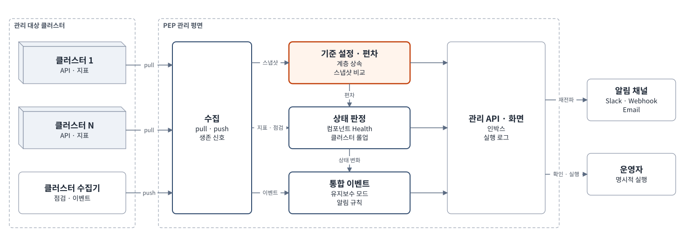
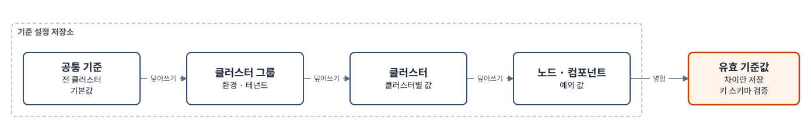
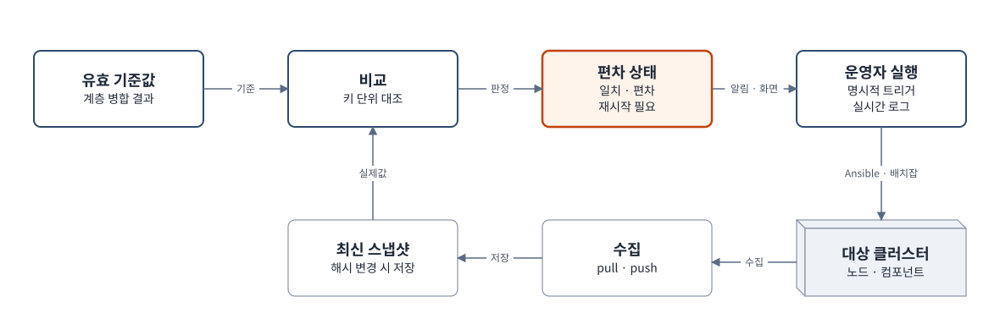
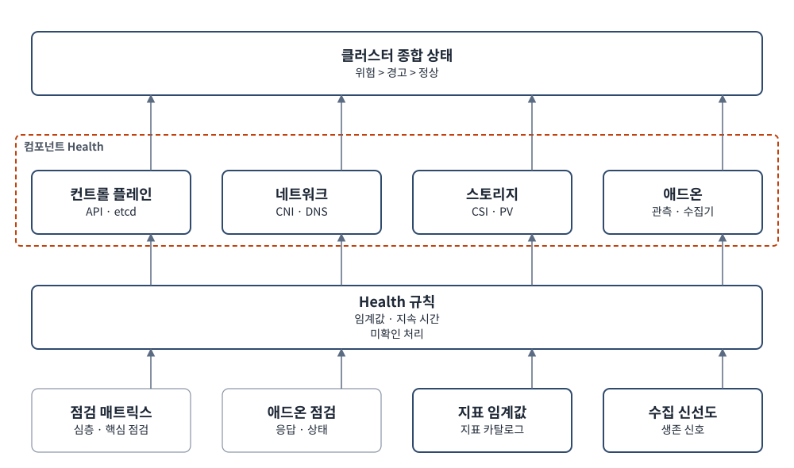
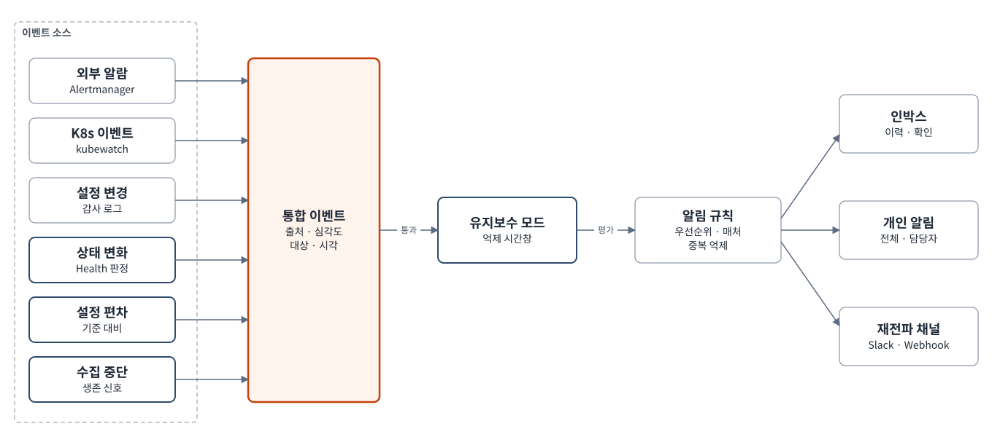

# PEP 운영 관리 평면 고도화 제안 — Cloudera Manager 설계 원리 적용

## 1. 개요

> 지금의 수집 · 점검 · 알림 기반은 그대로 두고, **기준 설정(Desired State) · 컴포넌트 단위 상태 판정 · 통합 이벤트** 세 축을 더해 "무엇이 기준과 다른가"를 PEP 가 스스로 판정하게 한다.

### 1-1. 배경

- Cloudera Manager(CM)는 하둡 계열 클러스터를 **기준 상태(Desired State) → 에이전트 수집 → Health 판정 → 이벤트 → 알림** 한 줄로 관리한다.
- PEP 는 이미 같은 줄의 대부분을 갖췄다. 수집(pull · push), 점검 매트릭스, 종합 상태 롤업, 설정 스냅샷, 알림 규칙이 운영 중이다.
- 비어 있는 곳은 세 군데다.
  - "어떤 값이어야 하는가"를 담는 **기준 설정**
  - 클러스터와 개별 점검 사이의 **컴포넌트 단위 상태**
  - 여러 화면에 흩어진 **이벤트를 한 흐름으로 묶는 계층**

### 1-2. 한 장 요약

| 구분 | 내용 |
|---|---|
| 유지 기반 | 설정 스냅샷 · 변경 이력, pull · push 이원 수집, 종합 상태 단일 롤업, 지표 카탈로그, 알림 규칙(우선순위 · 중복 억제 · 재전파) |
| 핵심 제안 1 | **기준 설정 계층** — 공통 → 클러스터 그룹 → 클러스터 → 노드 · 컴포넌트 순으로 덮어쓰기 |
| 핵심 제안 2 | **설정 편차 판정** — 기준값과 최신 스냅샷을 대조해 편차 · 재시작 필요를 표시. 조치는 운영자가 직접 실행 |
| 핵심 제안 3 | **컴포넌트 Health 계층** — 점검 · 애드온 · 지표 임계값 · 수집 신선도를 컴포넌트로 모은 뒤 클러스터로 롤업 |
| 핵심 제안 4 | **수집 생존 신호** — 수집이 끊긴 대상을 '정상'이 아니라 '미확인'으로 판정 |
| 핵심 제안 5 | **통합 이벤트 · 유지보수 모드** — 내부 이벤트도 기존 알림 규칙으로 보내고, 작업 시간창에는 알림을 억제 |
| 지키는 원칙 | 분석과 조치의 분리(자동 적용 없음) · UI-First(기준값 · 임계값은 화면에서 편집) · Fail-safe · 폐쇄망 동작 |

### 1-3. 목표 지표

| 지표 | 현행 | 목표 |
|---|---|---|
| 설정 편차 인지 | 운영자가 이력 diff 를 열어 판단 | 수집 1주기 안에 자동 판정 · 표시 |
| 수집 중단 인지 | 관측 화면 신선도 배지로 확인 | 신선도 임계 경과 시 '미확인' 판정 + 알림 |
| 클러스터 경고 원인 추적 | 점검 항목 단위 원인 목록 | 컴포넌트 → 항목 2단계 원인 추적 |
| 작업 중 알림 | 수동 무시 | 유지보수 시간창 안에서는 개인 알림 0건(인박스 기록은 유지) |
| 알림 소음 | — | PoC 에서 기준선 대비 측정 |

---

## 2. 현행 분석

> PEP 는 CM 의 수집 · 판정 · 알림 구조를 이미 상당 부분 갖췄다. 이번 제안은 이 기반을 **이어받아 확장**하는 것이며, 교체 대상은 없다.

### 2-1. 이어받는 기반

| 기반 | 현재 동작 | CM 대응 개념 | 판단 |
|---|---|---|---|
| 설정 스냅샷 · 변경 이력 | 컴포넌트 버전 · 파라미터를 해시가 바뀔 때만 저장, diff · 감사 로그 | Config History | **유지** |
| 커널 파라미터 편차 점검 | 호스트별 기준 대비 변경 감지 | Stale Config(부분) | **유지** → 제안 2로 일반화 |
| 이원 수집 | 중앙 pull(API · Prometheus) + 클러스터 내부 push(Super Pod · 수집기) | Agent → Host/Service Monitor | **유지** |
| 종합 상태 롤업 | 핵심 점검 · 애드온 · 심층 점검 · 매트릭스 항목을 위험 > 경고 > 정상으로 단일 집계, opt-in 반영 | Health Rollup | **유지** → 제안 3으로 계층 추가 |
| 지표 카탈로그 | 지표 · 임계값이 DB 행(화면에서 편집) | Charts · tsquery | **유지** |
| 알림 규칙 | 우선순위 첫 매칭, 모듈 · 알람명 · NS · 라벨 매처, 중복 억제, 심각도 재정의, Slack · Webhook · Email 재전파 | Alert Publisher | **유지** |
| 이벤트 수집 | 외부 알람(Alertmanager), K8s 이벤트(kubewatch), 감사 로그 | Event Server(부분) | **유지** → 제안 5로 통합 |

### 2-2. 운영 관찰 · 개선 기회

| 관찰 | 영향 | 개선 기회 |
|---|---|---|
| 스냅샷은 "무엇이 바뀌었나"만 알려 준다 | 의도된 변경과 이탈을 사람이 구분 | 기준값을 두고 "기준과 다른가"로 판정 |
| 지표 임계값이 화면 표시에만 쓰인다 | 지표 이상이 종합 상태에 반영되지 않음 | 임계값을 Health 규칙의 입력으로 승격 |
| 상태가 클러스터 ↔ 개별 항목 2단계다 | 원인 목록이 길어지면 영향 범위 파악이 늦음 | 컴포넌트 계층을 추가 |
| 수집이 끊겨도 마지막 판정이 남는다 | "정상"으로 오인할 수 있음 | 신선도 임계 경과 시 '미확인' |
| PEP 내부 판정 결과는 알림 규칙을 타지 않는다 | 외부 알람과 내부 판정의 라우팅이 다름 | 하나의 이벤트 모델로 묶기 |
| 계획 작업 중 알림을 끄는 수단이 없다 | 작업 중 알림 소음 | 유지보수 모드 |

### 2-3. CM 개념 대응

| CM | PEP 적용 | 다른 점 |
|---|---|---|
| Cluster → Service → Role → Role Config Group | 클러스터 그룹 → 클러스터 → 컴포넌트 → 노드 | 그룹 기준은 환경 · 테넌트(협의) |
| Desired State + Agent 자동 적용 | 기준값 + 편차 판정 | **자동 적용하지 않음** — 운영자가 실행(분석 · 조치 분리) |
| Stale Config(재시작 필요) | 편차 상태 · 재시작 필요 표시 | 판정 근거를 키 단위로 화면에 노출 |
| Safety Valve | 키 스키마 밖 값 = 자유 입력 | 허용 키 · 형식 검증 |
| Host/Service Monitor | 기존 pull · push 수집 | 메트릭 원천은 각 클러스터 Prometheus |
| Health Test · Trigger | Health 규칙(점검 · 지표 임계값 · 신선도) | 기존 opt-in 반영 정책 유지 |
| Event Server | 통합 이벤트 | 기존 저장소는 그대로, 조회 · 라우팅 계층만 추가 |
| Alert Publisher | 기존 알림 규칙 | 내부 이벤트를 입력으로 추가 |
| Maintenance Mode | 유지보수 모드 | 클러스터 · 컴포넌트 · 노드 단위 시간창 |

---

## 3. 전체 구조

> 수집 → (기준 설정 · 편차 / 상태 판정 / 통합 이벤트) → 관리 API · 화면의 한 방향 흐름으로 정리한다. 새로 생기는 곳은 가운데 세 블록이며, 수집과 화면 · 채널은 지금 그대로다.

> 편차 → 상태 변화 → 이벤트로 이어지는 세로 흐름이 이번 제안의 중심이다.

- 수집 계층은 pull · push 를 그대로 쓰고, 대상별 **생존 신호**(마지막 수신 시각)만 더한다.
- 기준 설정 · 편차 판정 결과는 상태 판정의 입력이 되고, 상태가 바뀌면 이벤트가 생긴다.
- 알림은 기존 규칙을 통과해 인박스 · 개인 알림 · 재전파 채널로 나간다. 조치는 운영자 화면에서 명시적으로 실행한다.

| 구성 | 판단 | 비고 |
|---|---|---|
| 수집(pull · push) | 유지 | 생존 신호 기록만 추가 |
| 기준 설정 · 편차 | 개선 | 신규 |
| 상태 판정 | 개선 | 기존 롤업에 컴포넌트 계층 · 입력 추가 |
| 통합 이벤트 · 유지보수 모드 | 개선 | 신규 조회 · 라우팅 계층 |
| 알림 규칙 · 채널 | 유지 | 입력 종류만 확장 |
| 관리 API · 화면 | 유지 | 화면 추가(기준 설정 · 이벤트 타임라인) |

---

## 4. 기준 설정 · 편차 판정

> 설정은 "바뀌었는가"가 아니라 **"기준과 다른가"** 로 판정한다. 기준값은 4단계로 덮어쓰고 차이만 저장하며, 조치는 운영자가 실행한다.

### 4-1. 기준 설정 계층

> 아래 단계가 위 단계를 덮어쓰고, 병합한 결과가 그 대상의 유효 기준값이 된다.

- 공통 기준 하나로 전 클러스터의 기본값을 정한다. 아래 단계에는 **기본값과 다른 값만** 저장한다(CM Role Config Group 과 같은 방식).
- 키는 스키마(이름 · 형식 · 허용 범위 · 설명)로 선언한다. 스키마 밖 값은 '자유 입력'으로 따로 표시해 남용을 막는다.
- 첫 기준값은 **현재 스냅샷을 가져와** 만들 수 있게 해 초기 등록 부담을 줄인다.

### 4-2. 편차 판정과 조치

> 판정은 자동, 조치는 사람이 한다. 조치 실행은 기존 Ansible · 배치잡 경로와 실시간 로그를 그대로 쓴다.

- 비교는 **키 단위**로 하고, 결과는 일치 · 편차 · 재시작 필요(설정은 맞지만 실행 중 값이 다름) 중 하나로 표시한다.
- 편차는 이벤트가 되고, 클러스터 종합 상태 반영은 기존과 같이 **opt-in** 이다.
- 조치 후 다음 수집에서 스냅샷이 갱신되면 편차가 자동으로 해소된다. 해소 여부가 곧 조치 검증이다.

| 항목 | 판단 | 근거 |
|---|---|---|
| 4단계 계층 · 차이만 저장 | 개선 | 기준값 부재 해소 |
| 키 스키마 · 자유 입력 구분 | 개선 | Safety Valve 남용 방지 |
| 비교 대상 = 기존 스냅샷 | 유지 | 수집 경로 재사용 |
| 조치 = 운영자 실행(Ansible · 배치잡) | 유지 | 분석 · 조치 분리 원칙 |
| 클러스터 그룹 기준(환경 / 테넌트) | 협의 | 운영 조직 기준 확인 필요 |
| 1차 적용 범위(커널 파라미터 · 컴포넌트 플래그 · CNI 설정) | 협의 | 우선순위 결정 필요 |

| 변경 | 효과 | 확인 지표 |
|---|---|---|
| 기준값 도입 | 의도된 변경과 이탈을 구분 | 편차 판정 건수 · 오탐 비율 |
| 자동 편차 판정 | 수집 1주기 안에 인지 | 편차 발생 → 표시까지 시간 |
| 조치 후 자동 해소 | 조치 결과를 따로 확인할 필요 없음 | 편차 해소까지 걸린 시간 |

---

## 5. 상태 판정 · 수집 생존 신호

> 클러스터와 개별 점검 사이에 **컴포넌트 계층**을 넣고, 지표 임계값과 수집 신선도를 판정 입력에 더한다. 데이터가 없으면 '정상'이 아니라 '미확인'이다.

> 네 가지 입력이 Health 규칙을 거쳐 컴포넌트 상태가 되고, 컴포넌트가 클러스터 종합 상태로 롤업된다.

- 입력 중 점검 매트릭스 · 애드온 점검은 지금 그대로 쓰고, **지표 임계값 · 수집 신선도**를 더한다.
- Health 규칙은 임계값과 **지속 시간**(예: N회 연속 위반)을 함께 봐 순간 튐을 거른다. 규칙은 화면에서 편집한다.
- 롤업 우선순위(위험 > 경고 > 정상)와 opt-in 반영 정책은 지금과 같다. '미확인'은 정상과 구분해 표시하고, 종합 상태 반영 여부는 협의로 정한다.

| 항목 | 판단 | 근거 |
|---|---|---|
| 컴포넌트 계층(컨트롤 플레인 · 네트워크 · 스토리지 · 애드온) | 개선 | 원인 추적 2단계화 |
| 지표 임계값 → Health 입력 | 개선 | 임계값이 표시에만 쓰이는 현상 해소 |
| 수집 생존 신호 · '미확인' 상태 | 개선 | 수집 중단을 정상으로 오인 방지 |
| 위험 > 경고 > 정상 롤업 · opt-in | 유지 | 현행 단일 롤업 재사용 |
| 컴포넌트 분류 목록 | 협의 | 현장 구성(CNI · CSI 종류)에 맞춰 확정 |
| 신선도 임계(수집 주기 × K) | 협의 | 수집 모드별 주기 확인 필요 |
| '미확인'의 종합 상태 반영 | 협의 | 경고로 볼지, 별도 표시만 할지 |

| 변경 | 효과 | 확인 지표 |
|---|---|---|
| 컴포넌트 계층 | 영향 범위를 한 번에 파악 | 경고 원인 확인까지 클릭 수 |
| 지표 임계값 반영 | 지표 이상이 종합 상태에 나타남 | 지표 기반 경고 건수 |
| 생존 신호 | 수집 중단을 신선도 임계 안에 인지 | 중단 → '미확인' 표시까지 시간(= 임계값 이내) |
| 지속 시간 조건 | 순간 튐으로 인한 상태 흔들림 감소 | 상태 전환 횟수(PoC 에서 기준선 대비 측정) |

---

## 6. 통합 이벤트 · 알림

> 외부 알람과 PEP 내부 판정을 **하나의 이벤트 모델**로 묶어 기존 알림 규칙으로 보낸다. 계획 작업 중에는 유지보수 모드가 알림을 억제한다.

> 기존 소스 3종(외부 알람 · K8s 이벤트 · 설정 변경)에 내부 판정 3종(상태 변화 · 설정 편차 · 수집 중단)을 더한다.

- 통합 이벤트는 출처 · 심각도 · 대상(클러스터 · 컴포넌트 · 노드) · 시각을 공통 필드로 갖는다. 기존 저장소는 그대로 두고 **조회 · 라우팅 계층**으로 묶는다.
- 유지보수 모드는 대상과 시간창을 지정한다. 창 안의 이벤트는 인박스에 기록하되 개인 알림 · 재전파는 하지 않는다.
- 알림 규칙(우선순위 · 매처 · 중복 억제 · 심각도 재정의 · 재전파)은 바꾸지 않고, 내부 이벤트를 매칭할 매처 값만 늘린다.

| 항목 | 판단 | 근거 |
|---|---|---|
| 통합 이벤트(조회 · 라우팅 계층) | 개선 | 흩어진 이벤트를 한 타임라인으로 |
| 내부 판정 이벤트 3종 | 개선 | 내부 판정도 같은 규칙으로 라우팅 |
| 유지보수 모드 | 개선 | 계획 작업 중 알림 억제 |
| 알림 규칙 · 중복 억제 · 재전파 채널 | 유지 | 현행 재사용 |
| 외부 알람 수신(Alertmanager receiver) | 유지 | 현행 재사용 |
| 유지보수 모드 ↔ Alertmanager silence 연동 | 협의 | 양쪽 억제 일치 여부 결정 필요 |
| 이벤트 보존 기간 | 협의 | 현행 알람 보존(90일)과 맞출지 결정 |

| 변경 | 효과 | 확인 지표 |
|---|---|---|
| 통합 이벤트 | 장애 전후 사건을 한 화면에서 시간순으로 확인 | 장애 분석 시 조회 화면 수 |
| 내부 이벤트 라우팅 | 담당자 지정 · 중복 억제가 내부 판정에도 적용 | 내부 이벤트 알림 건수 · 억제 건수 |
| 유지보수 모드 | 작업 시간창 안 개인 알림 0건 | 시간창 안 알림 건수 |

---

## 7. 기대 효과 종합

| 영역 | 변경 | 효과 | 확인 지표 |
|---|---|---|---|
| 설정 | 기준 설정 · 편차 판정 | 이탈을 수집 1주기 안에 자동 인지 | 편차 판정 건수 · 오탐 비율 · 해소 시간 |
| 상태 | 컴포넌트 계층 · 지표 임계값 | 원인 추적 2단계, 지표 이상의 상태 반영 | 원인 확인 클릭 수 · 지표 기반 경고 건수 |
| 수집 | 생존 신호 | 수집 중단을 신선도 임계 안에 인지 | 중단 → '미확인' 표시 시간 |
| 이벤트 | 통합 이벤트 · 내부 라우팅 | 한 타임라인, 같은 알림 규칙 | 조회 화면 수 · 알림 · 억제 건수 |
| 알림 | 유지보수 모드 | 작업 중 알림 소음 제거 | 시간창 안 알림 건수 |
| 전체 | — | 알림 소음 · 대응 시간 | PoC 에서 기준선 대비 측정 |

---

## 8. 적용 계획

> 판정 범위가 작고 위험이 낮은 것부터 단계적으로 켠다. 각 단계는 **섀도 모드**(판정만 하고 상태 · 알림에는 반영하지 않음)로 시작해 오탐을 확인한 뒤 반영한다.

| 단계 | 범위 | 완료 기준 |
|---|---|---|
| 1. 기반 | 수집 생존 신호, 통합 이벤트 조회, 유지보수 모드 | 수집 중단 시 '미확인' 표시, 이벤트 타임라인 조회, 시간창 억제 동작 |
| 2. 기준 설정 | 키 스키마 · 4단계 계층 · 스냅샷에서 기준값 가져오기 | 1차 범위 키 등록, 유효 기준값 화면 확인 |
| 3. 편차 판정 | 키 단위 비교 · 편차 이벤트(섀도) → 상태 반영(opt-in) | 섀도 기간 오탐 비율이 합의 기준 이하 |
| 4. 컴포넌트 Health | 컴포넌트 계층 · 지표 임계값 · 지속 시간 규칙(섀도 → 반영) | 원인 2단계 추적, 상태 전환 횟수 기준선 이하 |
| 5. 내부 이벤트 알림 | 내부 이벤트 3종을 알림 규칙에 연결 | 담당자 라우팅 · 중복 억제 동작 |

- 단계별 기간은 1차 적용 범위가 확정되면 산정한다(협의).
- 각 단계의 기능은 **설정으로 끄고 켤 수 있게** 해 언제든 현행 동작으로 되돌릴 수 있다.

---

## 9. 리스크 · 협조 요청

### 9-1. 리스크와 대응

| 리스크 | 대응 |
|---|---|
| 기준값 초기 등록 부담 | 현재 스냅샷에서 가져오기, 1차 범위 축소 |
| 편차 오탐(환경별 정상 차이) | 클러스터 · 노드 단계 덮어쓰기, 무시 키 지정, 섀도 모드 |
| 상태 판정 확대로 경고 증가 | opt-in 유지, 지속 시간 조건, 섀도 모드 |
| 이벤트 증가로 저장량 증가 | 보존 기간 정책 적용, 통합 이벤트는 조회 계층(중복 저장 없음) |
| 자동 조치 기대 | 범위 밖임을 명시 — 판정 · 알림까지만, 실행은 운영자 |
| 외부 의존(Prometheus 등) 장애 | 기존 Fail-safe 패턴 유지 — 해당 입력은 '미확인', 화면은 계속 동작 |

### 9-2. 의사결정 · 협조 요청

| # | 결정 · 요청 | 필요한 이유 |
|---|---|---|
| 1 | 클러스터 그룹 기준(환경 / 테넌트 / 별도 분류) | 기준 설정 2단계 정의 |
| 2 | 기준 설정 1차 적용 범위 | 단계 2 · 3 범위 확정 |
| 3 | 컴포넌트 분류 목록 | 현장 CNI · CSI · 애드온 구성 반영 |
| 4 | 신선도 임계와 '미확인'의 종합 상태 반영 방식 | 수집 모드별 주기 상이 |
| 5 | 유지보수 모드와 Alertmanager silence 연동 여부 | 억제 동작 일관성 |
| 6 | 섀도 모드 오탐 허용 기준 | 단계 3 · 4 반영 판단 |
| 7 | 이벤트 보존 기간 | 저장량 산정 |

---

## 부록 A. 검증 시험

| 시험 | 방법 | 합격 기준 |
|---|---|---|
| 기준 계층 병합 | 공통 · 그룹 · 클러스터 · 노드에 같은 키를 다른 값으로 지정 | 유효 기준값 = 가장 아래 단계 값 |
| 편차 판정 | 테스트 클러스터에서 기준 키 1개를 의도적으로 변경 | 수집 1주기 안에 '편차' 표시 + 이벤트 1건 |
| 편차 해소 | 운영자 실행으로 원복 | 다음 수집에서 '일치'로 전환 |
| 재시작 필요 | 설정 파일만 변경하고 프로세스는 유지 | '재시작 필요' 표시 |
| 생존 신호 | push 수집기 중지 | 신선도 임계 경과 후 '미확인' + 수집 중단 이벤트 |
| 지표 임계값 반영 | 지표 임계값을 현재 값 아래로 낮춤(지속 시간 N회) | N회 연속 위반 뒤에만 컴포넌트 경고 |
| 유지보수 모드 | 시간창 지정 뒤 경고 유발 | 인박스 기록 있음, 개인 알림 · 재전파 0건 |
| 내부 이벤트 라우팅 | 컴포넌트 매처 규칙 + 담당자 지정 | 지정 담당자에게만 알림, 반복분은 중복 억제 |
| Fail-safe | Prometheus 연결 차단 | 화면 정상, 해당 입력 '미확인' |
| 자동 조치 없음 | 편차 · 경고 상태 유지 | 클러스터 변경 실행 기록 없음 |
