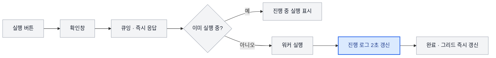

## 점검 매트릭스 상용화 전면 재검토 (2026-10)

홈 ▸ 플랫폼 현황 ▸ **점검 매트릭스**(행 = 점검 항목, 열 = 클러스터)를 실제로 운영해 본 결과
"버그가 많고 처음 쓰는 사람이 이해하기 어렵다" 는 이유로 **상용화 불가** 판정을 받았다.
이전 라운드에서 상용화 검토를 했지만 화면 표면(배지·문구) 위주였고, 실행 경로·권한·스케줄러처럼
눈에 안 보이는 곳은 손대지 않았다. 이번에는 백엔드부터 화면까지 전부 다시 봤다.

### 판정 요약

| 구분 | 감사에서 확인한 문제 | 이번 반영 |
|---|---|---|
| P0 (상용화 차단) | 16 | 16 |
| P1 (주요 결함·직관성) | 약 40 | 전부 |
| P2 (개선) | 약 40 | 직관성 핵심 위주 일부, 나머지는 백로그 |

결론: **P0·P1 을 모두 고친 상태에서 재검증을 거쳐 상용화 재판정을 받을 수 있는 수준**이다.
남은 P2 는 운영 편의 개선이라 출시를 막지 않는다.

### 감사 방법

네 영역을 나눠 코드를 끝까지 읽고, 문제마다 "입력 → 잘못된 결과" 를 재현 경로로 적었다.
추측으로 적은 항목은 버렸다.

1. 백엔드 서비스 — `check_matrix_service.py`(실행 생명주기·디스패처·그리드·정리)
2. 백엔드 라우터·런북 — 권한, 입력 검증, 응답 형태, 실행 계획과 실제 실행의 일치
3. 그리드 화면 — `PlatformStatusMatrix.tsx`, 훅, 상태 갱신
4. 모달·상세 화면 — 등록 마법사, 셀 상세, 실행 로그, 항목 상세

### 무엇이 문제였나

#### 1. 테넌트 격리에 구멍이 있었다

권한 가드는 **URL 경로에 있는 `cluster_id` 만** 검사했다. 클러스터를 본문·쿼리·항목으로 받는
엔드포인트는 그대로 지나갔다.

- 행의 "전 클러스터 실행" 이 **다른 테넌트에 묶인 클러스터까지** 실행했다.
- "미리 실행" 은 본문의 클러스터로 아무 클러스터에서나 플레이북을 돌릴 수 있었고, `check_mode=false`
  면 dry-run 없이 실제로 적용됐다(감사 로그도 없었다).
- 수행 로그 목록·상세, 항목 상세가 가려진 클러스터의 명령 출력까지 보여 줬다.
- 새 플레이북 카드의 대상 클러스터도 검사하지 않았고, 같은 이름의 라이브러리 파일은 조용히 덮어썼다.
- 런북과 실행 로그에 애드온 config 의 토큰이 그대로 노출됐다.

#### 2. 저장한 값이 조용히 사라졌다

- axios 응답 인터셉터가 JSON **키**를 camelCase 로 바꾼다. 항목 설정 API 는 임계값·파라미터를 dict 로
  내려 보냈고, 폼은 `label_selector` 를 찾다가 `labelSelector` 만 있으니 **기본값으로 채운 뒤 저장 때
  운영 값을 덮어썼다.**
- 커스텀 카드를 지우면 그 카드 전용 정의가 남았다. 아무도 물지 않게 된 순간 그 정의가 "공유 정의" 로
  오인돼 같은 종류의 다른 행이 **삭제된 카드의 URL·임계값으로** 돌았다.
- 마법사에서 입력한 값은 공유 정의가 이미 있으면 버려졌다 — 테스트는 입력값으로, 운영은 기존 값으로 돌았다.
- 수동 입력에 `NaN` 이 들어가면 그 뒤 그리드 API 가 모든 사용자에게 500 을 냈다.

#### 3. 실행 피드백이 없거나 틀렸다

- 셀 "지금 실행" 은 요청 안에서 끝까지 기다리는 **동기 실행**이었다. 프록시 타임아웃은 60초라 오래 걸리는
  점검은 504 로 끊겼고, 그동안 화면엔 스피너 하나뿐이었다.
- 셀 실행이 실패하거나 건너뛰어도 "실행했습니다" 토스트가 떴다.
- 확인창에서 **Enter 를 누르면 실행이 두 번** 나갔다(버튼 autoFocus + 창 전체 keydown 핸들러).
- 실행이 끝나도 로그 창을 닫으면 그리드가 최대 60초 동안 옛 값을 보여 줬다.
- 실행이 실패해도 셀은 마지막 성공 값을 계속 보여 줬다 — **어제 green 이 오늘도 green**.

#### 4. 스케줄러가 엉뚱한 시각에, 두 번씩 돌았다

- 주기를 새로 넣거나 바꾸면 기준점이 "하루 전" 이라 **저장 1분 안에** 실행됐다(14:00 에 `0 3 * * *` 저장 → 14:01 실행).
- 디스패처에 잠금이 없어 워커 적체 시 같은 셀이 두 번 큐잉됐다.
- 비활성 항목도 cron 으로 계속 돌았고, 수동 항목은 주기마다 "건너뜀" 로그를 쌓았다.
- 재시작할 때마다 주기가 비어 있는 모든 항목 × 클러스터에 기본 주기가 다시 붙었다.
- 대기열에서 차례를 기다리던 수행이 30분 기준으로 "워커 재시작" 오인 마감돼 영영 실행되지 않았다.

#### 5. 처음 쓰는 사람이 읽을 수 없었다

- 셀 기호(`—`, 점, 아이콘, 잠금, 중복 배지)를 설명하는 곳이 툴팁과 도움말뿐이었다.
- 셀에 마지막 점검 시각이 없어 7일 전 "정상" 과 방금 "정상" 이 똑같아 보였다.
- 클러스터 열 배지 하나가 "주기 꺼짐" 과 "클러스터 위험" 을 함께 표현해, 주기가 꺼진 위험 클러스터가 회색이었다.
- 범위가 전혀 다른 ▶ 세 개(셀·행·열)가 같은 아이콘이었다.
- 등록 마법사가 6~7단계에 "실행 기술 / 종류 / target_key / 전용 설정 분리" 같은 내부 용어였다.
- "실행 방식" 이 화면에 따라 다른 뜻이었다(소스 선택 라디오 vs 명령 목록 탭).
- 비활성 항목은 "그리드에서 숨김" 이라고 해 놓고 그대로 그렸다.

### 무엇을 고쳤나

#### 권한·감사

- 본문·아이템 경유 엔드포인트가 직접 operate 권한을 확인한다 — 행 실행은 실행 권한이 있는 클러스터만 대상이다.
- 수행 로그·항목 상세는 사용자 클러스터 범위로 거른다. 남의 수행 상세는 404.
- dry-run 없는 미리 실행, 공유 정의 직접 수정은 admin 만 할 수 있다.
- 변경·실행 엔드포인트 전부 감사 로그(`check_matrix.*`)를 남긴다.
- 비밀값으로 보이는 키는 런북·실행 로그에서 `********` 로 가리고, 가린 값이 그대로 돌아오면 원래 값을 유지한다.

#### 데이터 정합성

- 설정 API 는 값을 `[{name, value}]` 리스트로도 내려 보내 키 변환에 깨지지 않는다. 저장 시 필드 타입을 강제한다.
- 항목 삭제·소스 변경 시 전용 정의와 클러스터 오버라이드를 함께 지우고, 셀 값·이력을 비운다.
- 마법사 입력값이 공유 정의와 다르면 그 행 전용 정의로 분리해 입력값을 살린다.
- 이름·단위 길이, NaN, 조회 기간, 트리거 필터를 검증해 빈 500 을 없앴다.

#### 실행과 실시간 로그

모든 실행 버튼은 **큐잉 → 즉시 응답 → 실시간 로그** 한 경로로 통일했다.

- 수행마다 **진행 로그**(대기열 등록 → 실행 시작 → 대상 해석 → 단계 → 판정)가 시각과 함께 쌓인다.
- 실행하면 실행 로그 창이 자동으로 열린다. 표시 설정에서 끌 수 있고, 그래도 알림의 「로그 보기」 로 연다.
- 이미 대기·실행 중인 셀은 다시 큐잉하지 않는다(연타·cron 겹침 방지).
- 그리드 셀에 최근 수행 상태가 실려 "값은 이전 결과, 최근 실행은 실패" 가 보인다.
- 확인창은 Enter 이중 발화를 막고 처리 중에는 버튼을 잠근다.

#### 스케줄러

- 주기를 넣거나 바꾸면 기준점이 "지금" 이다 — 다음 예정 시각에 처음 돈다.
- 셀마다 조건부 갱신(claim)으로 한 디스패처만 발화를 가져간다. 늦게 집힌 디스패치는 버린다(expires 55초).
- 비활성·수동 항목은 돌지 않는다. 글로벌 정의 cron 은 클러스터 오버라이드가 있는 셀을 건너뛴다.
- 기본 주기는 기본 등록 항목에, 클러스터마다 **한 번만** 붙는다 — 새 클러스터 등록 시점에 바로 붙는다.
- 오래된 수행 정리는 실행 중 30분(시작 기준), 대기 90분으로 나눴다.

#### 화면

- **범례 줄** — 정상·경고·위험·대기·결과 없음·실행 중·오래된 결과·최근 실행 실패·핵심 항목.
- **셀** — 마지막 점검 상대 시각, 주기 최대 간격의 2배를 넘긴 결과는 흐리게, 최근 실행 실패 표식, 실행 중 스피너.
- **클러스터 열** — 상태 점과 주기 배지를 분리하고, 주기는 「매일 09:15, 13:15, 18:15」 처럼 사람 말로 보여 준다.
- **실행 버튼** — 「▶ 전체」(열), 「▶ 전 클러스터」(행), 셀 hover ▶ 로 범위를 글자로 구분했다.
- **주기 입력(CronInput)** — 입력 즉시 형식·5분 최소 간격 검증, 사람 말 설명, 다음 실행 3회(KST), 프리셋.
- **셀 상세 탭** — 값 입력(수동 항목 첫 탭) · 추이 · 이력 · 실행 주기 · 실행 계획 · 실행 기록 으로 말을 통일했다.
- **등록 마법사** — 점검 선택 → 설정 → 테스트·저장 3단계. 테스트는 선택이고 실행 로그를 그대로 보여 준다.
- 비활성 항목 기본 숨김, 같은 영역 안에서만 순서 변경, Firefox 드래그 지원, 일시적 갱신 실패에 표 전체를 지우지 않음.

### 후속 반영한 P2 백로그

1차 반영 때 백로그로 남긴 6건도 이어서 반영했다.

| 항목 | 조치 |
|---|---|
| 클러스터 종합 상태에 배치잡·플레이북·수동 항목 결과 반영 | 심층 점검과 같은 **opt-in** 정책으로 정했다 — 항목의 「클러스터 상태에 반영」(기본 꺼짐)을 켠 행만 집계한다. 같은 종류 심층 점검 카드 여러 장을 하나로 접던 문제도 계보(lineage) 단위 집계로 고쳤다 |
| 기본 항목 시드의 다중 레플리카 경합 | 시드 트랜잭션에 PostgreSQL advisory lock — 뒤에 온 레플리카는 기다렸다가 "이미 있음" 으로 빠진다 |
| 이력 정리의 일일 상한(250k 행/테이블) | 행 수 상한 대신 시간 예산(240초) — 예산 안에서는 끝까지, 남으면 `remaining` 으로 알리고 다음 날 이어서 |
| 플레이북 실행 타임아웃 30초 고정 | `playbooks.timeout_seconds`(10~1800초)를 /playbooks 화면에서 정한다. 매트릭스 셀 태스크 한도도 그만큼(+60초) 늘린다 |
| 배치잡 런북의 비-SSH 실행기 표기 | 실행기의 `requires_ssh`·스크립트 종류(python/shell/ansible)에 맞춰 K8s API / SSH / ansible-playbook 으로 적는다 |
| 표 대체 보기 | 툴바 「표 / 목록」 — 영역 → 항목 → 클러스터 칩 1열 목록(1024px 미만 기본). 「문제만」 필터도 추가 |

### 재검증 체크리스트

상용화 재판정 전에 아래를 실제 화면에서 확인한다.

1. viewer 계정 — 모든 실행·주기·편집 버튼이 흐리고, 마우스를 올리면 사유가 보인다.
2. 테넌트 A operator — B 테넌트 클러스터 열은 보이지 않고, 행 「▶ 전 클러스터」 가 A 클러스터만 실행한다.
3. 셀 ▶ → 확인창에서 Enter 연타 → 수행은 1건만 생기고 실행 로그 창이 바로 열린다.
4. 60초 넘게 걸리는 점검 — 504 없이 끝까지 진행 로그가 갱신되고, 끝나면 셀이 즉시 바뀐다.
5. 14:00 에 `0 3 * * *` 저장 → 다음 실행이 「다음 날 03:00」 으로 보이고, 저장 직후 실행되지 않는다.
6. 기본 등록 항목의 임계값을 바꿔 저장 → 다시 열었을 때 바꾼 값이 그대로 보인다.
7. kubeconfig 를 깨뜨린 클러스터 — 셀은 이전 값이지만 모서리에 실패 표식, 상세에 「최근 실행 실패 — 원인 보기」,
   실행 로그 마감 줄에 "kubeconfig 를 다시 등록하세요" 안내. (정의 없는 셀은 같은 자리에 「최근 실행 건너뜀」.)
8. 등록 마법사 — 3단계로 등록, 테스트 로그 확인, 값을 바꾸면 이전 테스트 결과가 지워진다.

### 재검증 결과 (2026-10-13, v1.50.0)

실제 앱(uvicorn + celery worker + vite, 전용 DB)에서 Playwright 로 구동해 확인했다. **8/8 통과.**

| # | 결과 | 근거 |
|---|---|---|
| 1 | 통과 | viewer 로 전 버튼 `disabled` + "operator 이상 권한이 필요합니다 (현재: viewer)". API 직접 호출 403. 이때 aria-label 이 사유로 덮여 버튼 이름이 사라지는 접근성 결함을 찾아 `ariaWithHint` 로 고쳤다 |
| 2 | 통과 | op-a 그리드에 dev-busan-02 열 없음. 행 ▶ 수행이 prod-seoul-01·stg-open-03 에만 생성(DB) |
| 3 | 통과 | Enter 3회 → `manual_cell` 수행 1건, 로그 패널 141ms 에 열림 |
| 4 | 통과 | 75초 HTTP 프로브 — POST 107ms 에 queued, 504 없음, "실행 중 — 2초마다 갱신", 끝나자 새로고침 없이 셀 갱신. 샌드박스에서 ansible 이 돌지 않아 플레이북 대신 HTTP 프로브로 확인 |
| 5 | 통과 | 「매일 03:00 / 다음 실행: 10/14(수) 03:00」, 저장 응답 `last_run_at` = 저장 시각, `dispatch_due` 1회 → 발화 0 |
| 6 | 통과 | CoreDNS `label_selector`·`log_tail_lines` 저장 후 재조회·DB 정의 일치 |
| 7 | 통과(문구 정정) | 깨진 kubeconfig → 수행 `완료` + 셀 **위험** + `kubeconfig 로드 실패` 사유. 정의 없는 셀 → 이전 값(정상 361일) 유지 + 「최근 실행 건너뜀 — 원인 보기」 → 실행 기록 탭으로 이동. 이때는 연결 실패도 「위험」 으로 칠해졌다 → **후속 반영**: kubeconfig·연결·TLS 수집 실패를 실행 실패로 분리해 셀이 이전 값 + 실패 표식을 유지하게 바꿨다(체크리스트 원문 동작) |
| 8 | 통과 | 점검 선택 → 설정 → 테스트·저장 3단계, 테스트 결과 정상 + 상세 로그 63줄, timeout 값 변경 → 요약 「테스트 · 건너뜀」 으로 이전 결과 무효, 저장 후 그리드에 행 표시 |

### 관련 문서

- 운영 매뉴얼: `docs/CHECK_MATRIX_GUIDE.md`
- 화면 명세: `docs/SCREENS.md` 「홈 (`/`)」 · 「항목 상세 (`/checks/:itemId`)」
- 회귀 테스트: `backend/tests/test_check_matrix_commercial.py`
