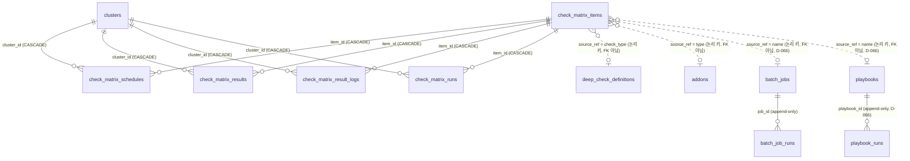

# 점검 매트릭스 운영 매뉴얼 (홈 ▸ 플랫폼 현황)

홈 화면(`/`)의 **플랫폼 현황** 모드에 있는 점검 매트릭스 — 행(점검 항목) × 열(클러스터) —
를 실제로 운영하기 위한 문서다. 화면 안에서도 카드 헤더의 **?** 아이콘으로 같은 내용을
요약해 볼 수 있다.

- 화면 구조/파일 매핑: `docs/SCREENS.md` 의 「홈 (`/`)」 섹션
- Deep Check 체커 자체를 새로 만드는 법: `docs/DEEP_CHECKER_GUIDE.md`
- 코드 위치: `backend/app/routers/check_matrix.py` · `backend/app/services/check_matrix_service.py`
  · `backend/app/services/check_matrix_runbook.py` · `frontend/src/components/platform-status/`

---

## 1. 한 장 요약

| 하고 싶은 것 | 어디서 |
|---|---|
| 셀 기호(흐림·모서리 표식·스피너 등)의 뜻 | 표 위 **범례 줄** (표시 설정에서 켜고 끔) |
| 이 점검이 내 클러스터에서 **무슨 명령을 도는지** 보기 | 셀 클릭 → **실행 계획** 탭 |
| 기본 등록 점검의 **임계값·파라미터 확인/수정** | 셀 클릭 → **실행 계획** 탭 → **설정 편집** |
| **셀 1개**만 지금 실행 | 셀에 마우스를 올려 **▶**, 또는 셀 클릭 → 우측 상단 **지금 실행** |
| **클러스터(K8s) 전체** 점검 실행 | 클러스터 열 머리글 **「▶ 전체」** |
| **공통 점검 항목**을 전 클러스터에 실행 | 행의 **「▶ 전 클러스터」** |
| 실행 진행을 **실시간 로그**로 보기 | 실행하면 **실행 로그 창**이 자동으로 열림(표시 설정에서 끄면 알림의 「로그 보기」) |
| 지난 실행 기록(명령·출력·실행자) 보기 | 툴바 **실행 로그**, 또는 셀 클릭 → **실행 기록** 탭 |
| 셀 하나의 자동 실행 주기 바꾸기 | 셀 클릭 → **실행 주기** 탭 (입력 즉시 검증·다음 실행 미리보기) |
| 자동 실행 주기 바꾸기 | 항목명 클릭 → 항목 상세(`/checks/:itemId`) **적용** 탭 — 클러스터별 한 표(D-065) |
| 항목의 정의·테스트·로그·히스토리를 한 화면에서 보기 | 행의 **항목명** 클릭 → 항목 상세(`/checks/:itemId`, R-4 6차 라운드 4단계) |
| 이력 보관 기간 바꾸기 | 카드 헤더 톱니바퀴 |

실행(수동 트리거)과 항목/일정 변경은 **operator 이상** 권한이 필요하다. 조회는 로그인한
사용자면 누구나 가능하다.

---

## 2. 셀이 채워지는 3가지 방식 + 1

행마다 **실행 소스(`source_type`)** 가 정해져 있고, 이것이 그 행의 모든 동작을 결정한다.

셀에는 상태색과 함께 **대표값 숫자**가 표시된다 — 상태색은 판정, 숫자는 여유를 즉시 읽게 한다.

| 점검 | 셀 숫자 | 단위 |
|---|---|---|
| 인증서 만료 | 가장 짧은 인증서 잔여일 | 일 |
| etcd 단편화 / Hubble drop / CoreDNS 에러율 / HTTP·MinIO·pod 프로브류 | 비율 | % |
| ImagePull·CrashLoop / OOM / Stuck Terminating / PVC / 커널 파라미터 변경 | 건수 | 건 |
| 노드 Pressure / 노드 추가 검증 | 이상 노드 수 | 대 |
| cluster-admin sprawl | 대상자 수 | 명 |
| 커스텀 kubectl / PromQL | 측정값 그대로 | (항목 unit) |

대표값 규칙은 `registered_checks/registry.py` 의 `CELL_VALUE_SPECS` 가 원천이고, 시드 시 항목
unit 도 여기서 채워진다(구버전 DB 는 부팅 시 자동 보강).

**영역 구분과 행 색** — 행마다 `영역(category)`(k8s/network/storage/os/app 또는 자유 문자열)과
`행 배경 색`(8색 프리셋)을 줄 수 있다. 행에 색 띠·배경 틴트와 영역 칩이 표시돼 어떤 영역
점검인지 한눈에 구분된다. 기본 등록 항목은 체커의 도메인에서 영역·기본 색이 자동으로 채워지고
(구버전 DB 는 부팅 시 보강), 항목 수정에서 언제든 바꿀 수 있다. 색은 hex 가 아니라 테마 대응
차트 토큰 프리셋(`chart-1`..`chart-8`)으로 저장된다 — 다크/라이트 테마를 자동으로 따라간다.
**행 순서는 이름 왼쪽 그립(⋮⋮)을 드래그**해서 바꾼다.

**대상 중복 표시(`target_key`, D-062)** — `source_type`/`source_ref` 가 달라도 실제로는 같은
컴포넌트를 가리키는 행이 있다(예: `etcd_defrag`(deep_check, kubectl/스냅샷)와 `etcd-leader`
애드온(k8s_api) 이 둘 다 etcd 를 점검). `category` 와 같은 철학의 자유 문자열
(`target_key`, 항목 수정에서 편집)을 같은 값으로 맞추면, 두 행 이상이 **서로 다른 실행기술**로
같은 대상을 점검할 때만 매트릭스/항목 상세에 "N개 실행기술 중복" 배지가 뜬다(같은 대상이라도
실행기술이 전부 같으면 — 예: 수동 입력 행 2개 — 중복 경고를 띄우지 않는다, 판정은
`check_matrix_service._target_duplicate_map()`). 값이 없으면 판정 대상에서 빠질 뿐 다른 동작에
영향 없음 — 시드는 실제로 겹치는 것이 확인된 조합(`etcd`/`node`/`coredns`/`certificate`)만
기본값으로 채우고, 나머지는 운영자가 화면에서 직접 채운다(추측 강요 금지).

| 소스 | 실행 주체 | cron 위치 | 대상 해석 |
|---|---|---|---|
| `core_bundle` | `DailyChecker.run_daily_check()` | 클러스터 열 (`Cluster.check_cron_expr`) | 클러스터 자체 |
| `deep_check` | `DeepCheckService` → 체커 | 셀(항목×클러스터) 또는 정의의 `schedule_cron` | `check_type` → `DeepCheckDefinition` |
| `addon` | `HealthChecker` | 셀(항목×클러스터) | `Addon.type` → 그 클러스터의 `Addon` |
| `batch_job`(D-066) | `batch_job_service.execute_job` | 셀(항목×클러스터) | `BatchJob.name` → 그 클러스터의 `BatchJob` |
| `playbook`(D-066) | `playbook_service.execute_playbook_run` | 셀(항목×클러스터) | `Playbook.name` → 그 클러스터의 `Playbook` |
| `manual` | 없음 (사람이 입력) | — | — |

### 2.1 Deep Check — 점검 정의를 실행

PEP 내장 점검기(인증서 만료, etcd 단편화, PVC, CoreDNS, OOM, 노드 Pressure 등)를 돌린다.

1. 항목 추가/수정에서 실행 방식을 **Deep Check** 로 두고 점검 종류(`check_type`)를 고른다.
   여기서 고른 값은 **논리 키일 뿐**이고 임계값·파라미터를 담지 않는다.
2. 실행 시점에 대상을 이렇게 해석한다.
   - ⓪ **행 전용 정의**(`CheckMatrixItem.definition_id`)가 있으면 그 계보 안에서만 해석한다 —
     그 정의를 부모(`parent_id`)로 둔 이 클러스터 오버라이드가 있으면 그것, 없으면 전용 정의 자신.
   - ① 전용 정의가 없으면 **이 클러스터 전용 공유 정의**(`cluster_id == 이 클러스터`)를 찾고,
   - ② 없으면 **글로벌 정의**(`cluster_id IS NULL`)로 넘어간다.
   - ③ 둘 다 없으면 이 셀은 실행되지 않고 **건너뜀(skipped)** 으로 로그에 남는다.
3. **임계값(thresholds)·파라미터(params)는 점검 정의에 저장된 값**이 쓰인다. 바꾸는 곳은 세 군데다.
   - **항목 수정**(행 전체 기준값) — 임계값/파라미터 폼이 뜬다. `이 항목 전용 설정으로 분리`를
     켜고 저장하면 행 전용 정의가 만들어져, 같은 점검 종류를 쓰는 **다른 행은 영향받지 않는다**.
   - **셀 → 실행 계획 탭 → 설정 편집** — 그 클러스터 전용 오버라이드(copy-on-write)를 만든다.
   - **운영 점검(Ops Checks)** 화면 — 정의를 직접 편집.

   전용 정의로 분리하기 전에는 그 값이 같은 `check_type` 을 쓰는 다른 행과 공유된다 — 폼과
   런북이 어느 쪽인지("이 항목 전용" / "글로벌" / "이 클러스터 전용") 항상 명시한다.
   **공유 정의를 그대로 고치는 것은 admin 만** 할 수 있다(전 클러스터·다른 테넌트 클러스터까지
   퍼지기 때문) — operator 는 "이 항목만 따로 설정" 으로 분리해 저장한다(아니면 403).
   항목을 삭제하거나 실행 소스를 바꾸면 그 행 전용 정의(와 클러스터 오버라이드)도 함께 지워진다 —
   예전엔 남은 정의가 공유 정의로 오인돼 같은 종류의 다른 행이 삭제된 카드의 설정으로 돌았다.
4. cron 은 두 경로가 있다.
   - **셀 cron** (`CheckMatrixSchedule`) — 이 화면에서 셀별로 설정. 항목별·클러스터별로 다르게 줄 수 있다.
   - **정의 cron** (`DeepCheckDefinition.schedule_cron`) — 정의 자체의 단독 스케줄. 글로벌 정의면
     전 클러스터 대상으로 발화한다. 이 경로로 실행돼도 매트릭스에 같은 `check_type` 행이
     있으면 그 셀의 수행 로그로 함께 남는다.
   - 둘 다 **최소 5분 간격**이며, 그보다 촘촘한 cron 은 저장 단계에서 422 로 거부된다(화면의
     주기 입력은 저장 전에 같은 규칙으로 막고, 사람 말 설명과 다음 실행 3회를 서버 기준 시간대로 보여 준다).
   - 주기를 **새로 넣거나 바꾸면 기준점이 "지금"** 이 되어, 저장 직후가 아니라 다음 예정 시각에
     처음 돈다(예전엔 기준점이 하루 전이라 14:00 에 `0 3 * * *` 를 넣어도 1분 안에 실행됐다).
   - 디스패처는 셀마다 `last_run_at` 을 조건부로 갱신(claim)해, 워커 적체로 디스패치가 겹쳐도 같은
     셀이 두 번 큐잉되지 않는다. 비활성 항목·수동 입력 항목은 주기가 있어도 돌지 않는다.
   - 기본 주기(`15 9,13,18 * * *`)는 **기본 등록(seed) 항목에만, 클러스터마다 한 번** 붙는다 — 새
     클러스터를 등록하면 그때 붙고, 재시작할 때마다 다시 붙지 않는다(운영자가 비워 둔 주기 보존).
   - 글로벌 정의의 `schedule_cron` 이 전 클러스터로 퍼질 때, 클러스터 전용 오버라이드가 있는
     셀은 건너뛴다(그 셀은 자기 셀 주기로 오버라이드 값으로 돈다).
5. 커스텀 타입(`custom_http` / `custom_kubectl` / `custom_promql`)은 같은 `check_type` 으로
   여러 정의를 만드는 템플릿형이라 매트릭스 기본 행으로 **시드되지는** 않는다. 다만 행 전용
   정의(`definition_id`)가 생긴 뒤로는 매트릭스에 올려도 모호하지 않다 — 등록 마법사에서
   `직접 만들기`로 고르면 행마다 자기 정의를 갖고 등록되므로, 대상만 다른 카드를 원하는
   만큼 만들 수 있다(§2.3b).

### 2.2 Addon — 등록된 애드온을 헬스 체크

클러스터에 등록해 둔 애드온(etcd, ArgoCD, Nexus, Jenkins, Keycloak, 시스템 파드 등)을 본다.

1. 실행 방식을 **Addon** 으로 두고 애드온 **타입**을 고른다.
2. 실행 시점에 `Addon.type == 고른 타입 AND Addon.cluster_id == 이 클러스터` 로 인스턴스를
   찾는다. 그 클러스터에 등록돼 있지 않으면 **건너뜀**이다.
3. 접속 주소·인증정보는 애드온의 `config` 에서 온다(비어 있으면 클러스터 내부 기본 주소 —
   예: `http://nexus.devops.svc:8081`). 실제로 어떤 URL 을 두드리는지는 **실행 계획** 탭에서
   확인할 수 있다.
4. 결과는 매트릭스 셀뿐 아니라 **애드온 자체의 상태**도 갱신하고, 그 값이 클러스터 전체 상태
   재계산에 반영된다.
5. 애드온 행에는 기본 cron 이 시드되지 않는다 — 자동 실행을 원하면 셀에서 cron 을 직접 넣는다.

### 2.3 Batch Job / Playbook — 등록된 SSH 잡·Ansible 플레이북 실행(D-066)

`/batch-jobs`·`/playbooks` 화면에 이미 등록해 둔 SSH bash/python 잡, Ansible 플레이북을
매트릭스 행으로도 실행·스케줄링할 수 있다. deep_check/addon 처럼 "논리 키(이름) → 클러스터별
인스턴스" 해석 방식을 그대로 따른다 — `BatchJob`/`Playbook` 은 원래 클러스터별 행이므로, 여러
클러스터에 **같은 이름**으로 등록해 두면 한 행이 여러 열에서 각자 실행된다.

1. 항목 추가에서 실행 방식을 **SSH(bash/python)** 또는 **Ansible** 로 두고, 이미 등록된
   배치잡/플레이북 이름을 고른다 — 여기서는 **새로 만들지 않는다**(임계값/설정 입력 단계가
   없다). 등록 마법사 "테스트" 단계는 실제 실행을 하지 않는다(운영 스크립트라 부작용이 있을
   수 있어 안전을 위해 생략).
2. 실행 시점에 `BatchJob.name == source_ref AND BatchJob.cluster_id == 이 클러스터`(플레이북도
   동일 패턴)로 해석한다. 그 클러스터에 같은 이름이 없으면 **건너뜀**이다.
3. 자격증명은 배치잡에 **저장된 스케줄용 자격증명**(`encrypted_password`/`encrypted_private_key`)
   만 쓴다 — 매트릭스 실행(cron 포함)은 무인 실행이라 매번 입력받을 수 없다. 저장된 자격증명이
   없으면 그 사유가 실행 로그 메시지에 그대로 남는다. 플레이북은 인벤토리에 이미 있는 SSH
   설정을 그대로 쓴다(둘 다 `/batch-jobs`·`/playbooks` 화면에서 직접 실행할 때만 인라인
   자격증명 입력을 받는다).
4. 배치잡/플레이북의 **params/스크립트 내용 편집은 이 화면에서 하지 않는다** — 중복 UI를
   피하기 위해 `/batch-jobs`·`/playbooks` 화면 전용이다(셀 상세 "실행 계획" 탭의 "설정 편집"
   버튼이 뜨지 않는다).
5. 실행 결과는 매트릭스 수행 로그뿐 아니라 각 화면의 자체 이력(`BatchJobRun`/`PlaybookRun`)에도
   남는다 — 어느 쪽에서 봐도 같은 실행을 확인할 수 있다.

### 2.3b 커스텀 카드 — "정해진 카드" 밖으로 나가기

등록 마법사(점검 항목 추가)의 **종류** 단계는 등록된 점검 종류 목록만 보여주는 곳이 아니다.
목록 아래 **직접 만들기** 구역에 서버가 알려주는 선택지가 함께 뜬다(프론트 하드코딩 아님 —
`GET /check-matrix/exec-techs` 의 `creatable`).

**(1) 새 플레이북 만들어 등록 (Ansible)** — 내가 쓴 Playbook 을 그 자리에서 등록해 점검으로 돌린다.

1. 종류 단계에서 `새 플레이북 만들어 등록` 선택 → **플레이북 작성** 단계가 생긴다.
2. 이름 · YAML 본문(직접 작성 / `.yml` 파일 불러오기 / 플레이북 라이브러리에서 불러오기) ·
   태그 · extra vars · **실행할 클러스터(열)** 를 지정한다.
3. **테스트** 단계에서 고른 클러스터에 1회 실행해본다 — 기본은 `ansible --check`(dry-run)라
   실제 변경이 나가지 않는다. 결과 아래 **로그 보기**로 ansible 출력 전체를 확인한다.
4. **적용** 하면 다음이 한 번에 만들어진다:
   - `AnsiblePlaybookFile` 1건 — YAML 본문(공용 라이브러리, `/playbooks` 화면에서도 보인다)
   - 선택한 클러스터마다 `Playbook` 1건 — 같은 이름의 실행 단위
   - `source_type=playbook`, `source_ref=<플레이북 이름>` 인 매트릭스 행

   이후 동작은 기존 `playbook` 소스와 동일하다(§2.3) — 셀 cron·수동 실행·`PlaybookRun` 이력.
   같은 이름으로 다시 등록하면 새로 만들지 않고 본문/설정을 갱신한다.

   인벤토리는 **그 클러스터의 기본 인벤토리 → 없으면 K8s 노드 목록(동적)** 순으로 해석된다.

**(2) 커스텀 점검(HTTP/kubectl/PromQL)의 새 인스턴스** — 대상만 다른 카드를 여러 장 만든다.
`custom_http`/`custom_kubectl`/`custom_promql` 같은 템플릿형 체커는 이제 **행마다 자기 정의**를
가질 수 있어 "사내포털 프로브"와 "객체스토리지 프로브"를 각각 카드로 둘 수 있다(§2.1의 행 전용 정의).

**(3) SSH bash/python** — 자격증명이 필요해 마법사에서 바로 만들지 않는다. `/batch-jobs`(또는
`/scripts` 의 스크립트를 참조하는 배치잡)에서 잡을 먼저 등록하면, 그 이름이 종류 목록에 나타난다.

### 2.4 수동 입력 — 자동 체커가 없는 대상

NAS 콘솔, 네트워크 스위치, 외주 점검 결과처럼 PEP 가 직접 찌를 수 없는 대상을 같은 매트릭스
위에서 함께 관리한다.

1. 항목 추가에서 실행 방식을 **수동 입력**으로 만든다(점검 종류/애드온 타입은 고르지 않는다).
2. 값을 넣을 셀을 클릭하고 **추이 · 이력** 탭의 **값 입력**에서 상태(정상/경고/위험/대기),
   수치(선택), 메모(선택)를 저장한다.
3. 입력한 값도 자동 점검과 똑같이 이력에 쌓여 추이 차트·변경 이력이 동일하게 동작하고,
   **누가 언제 넣었는지**가 수행 로그에 `수동 입력` 트리거로 남는다.
4. 자동 실행이 없으므로 cron 을 설정할 수 없고 ▶ 실행 버튼도 나오지 않는다. 값을 넣기
   전까지 셀은 `—`(미실행)로 남는다.

### 2.5 핵심 항목(잠금) — `core_bundle`

「K8S API-SERVER 응답시간」 행은 `DailyChecker.run_daily_check()` 를 **원자적으로 한 번**
실행하고 그중 `/healthz` 응답시간만 셀에 투영한 것이다.

- `Cluster.status`(사이드바 클러스터 색)는 `services/cluster_status_service.py::recompute()` 가
  핵심 번들·애드온·opt-in 심층 점검 결과를 모아 계산한다(`/clusters/:id` 클러스터 상세의 "종합
  상태" 카드에 그 원인이 그대로 보인다) — 이 행이 유일한 writer 는 아니지만, 이 실행이
  **미연결(pending) 판정의 유일한 근거**다. 이 셀이 pending 이면 다른 신호와 무관하게 클러스터
  전체가 pending 으로 표시된다(연결도 안 되는데 애드온이 healthy 라고 우길 수 없기 때문). 그래서
  항목별 cron 이 아니라 **클러스터 열의 cron** 으로 스케줄하고 삭제할 수 없다(비활성화로 숨기기만
  가능). 이름/설명/단위/표시 여부는 다른 행과 똑같이 수정할 수 있다 — 잠기는 건 실행 소스뿐이다.
- 하위 4개 점검(API 서버 / 컴포넌트 / 노드 / 시스템 파드)을 따로 돌릴 수 없는 이유도 같다 —
  종합 판정이 한 번의 실행에서 나와야 한다.
- 판정 기준: `/healthz` 200 이고 3000ms 미만 → 정상, 200 이지만 3000ms 이상 → 경고,
  그 외(비200·연결 실패) → 위험.

---

## 2.6 클러스터 상태에 반영 (opt-in)

배치잡·플레이북·수동 입력 행은 점검 정의가 없어 기본으로는 클러스터 종합 상태(`Cluster.status`)에 들어가지 않는다.
항목 수정(또는 등록 마법사 설정 단계)의 **「클러스터 상태에 반영」** 을 켜면, 그 행의 최근 판정이 경고·위험일 때
클러스터도 경고·위험이 되고 `/clusters/:id` 「종합 상태」 원인 목록에 「매트릭스 항목」 으로 나온다. 대기(pending)는
집계에서 빠지고, 비활성 행도 빠진다. 등록된 점검은 정의의 같은 스위치(운영 점검 화면), 애드온은 항상 반영이다.
심층 점검은 **정의 계보 단위**로 집계한다 — 같은 종류의 커스텀 카드가 둘이면 각각 따로 본다(하나가 위험이면 위험).

## 3. 무슨 명령이 도는지 확인하기 (실행 계획 탭)

셀을 클릭하고 **실행 계획** 탭을 열면 그 셀의 **런북**이 나온다. 애드온 config 의 토큰·비밀번호처럼
비밀값으로 보이는 키(token/password/secret/api_key/private_key/credential)는 `********` 로 가려지고,
가린 값을 그대로 저장하면 원래 값이 유지된다.

- **실행 대상** — 이 클러스터에서 해석된 실제 대상(정의 이름 / 애드온 이름). 대상이 없으면
  그 이유와 해결 방법이 함께 뜬다.
- **실행 단계** — 점검이 거치는 단계 흐름.
- **수행되는 명령** — 순서대로 나열되며 종류가 배지로 구분된다.

| 배지 | 뜻 |
|---|---|
| `kubectl` | PEP 백엔드 컨테이너에서 `kubectl --kubeconfig <클러스터 kubeconfig> --server <api_endpoint> …` 로 실행 |
| `K8s API` | kubernetes python SDK 로 API 서버 직접 호출 (kubectl 바이너리 불필요) |
| `HTTP` | 대상 엔드포인트로 직접 HTTP 호출 |
| `SSH` | 대상 장비에 SSH 접속해 읽기 명령 실행 (Isilon NAS 등) |
| `PEP DB` | 대상 클러스터에 접속하지 않고 PEP 내부 데이터만 사용 |
| `변경` | 대상에 변경을 일으킬 수 있는 명령 (예: pod-to-pod 프로브 파드 생성/삭제) |

- **적용되는 설정값** — 실제로 그 명령에 꽂히는 params/thresholds.
- **설정 편집** — 기본 등록된 점검의 임계값·파라미터(애드온이면 config)를 이 자리에서 바로
  수정할 수 있다(operator 이상). 값은 필드 타입(int/float/boolean/list/string)으로 강제되고,
  **비우면 해당 오버라이드가 제거돼 기본값으로 복귀**한다. 셀이 **글로벌 정의**를 쓰고 있으면
  저장 시 그 값을 복제한 **이 클러스터 전용 정의**가 자동으로 만들어지고 그 사본만 바뀐다
  (copy-on-write — 다른 클러스터는 영향 없음). 필드 라벨과 도움말은 입력칸 위·아래에 그대로
  보이고, boolean 은 "(기본값)" 을 고를 수 있다. (API: `PUT /cell/{item_id}/{cluster_id}/source-config`)
- **알아둘 점** — 사전 조건(권한/설치 여부)과 판정 규칙.

> 런북은 체커 구현과 1:1 로 맞춰 관리한다(`check_matrix_runbook.py`). 체커의 명령이 바뀌면
> 같은 커밋에서 런북도 바꾼다 — `tests/test_check_matrix_runs.py` 가 모든 `check_type` /
> 애드온 타입에 런북 명령이 있는지 검사한다.

---

## 4. 실행하기 — 3가지 단위

### 4.1 셀 1개 (개별 수행)

셀에 마우스를 올려 **▶**(확인창을 거친다), 또는 셀 클릭 → 우측 상단 **지금 실행**. 요청은
**큐잉 후 즉시 돌아오고**(예전 동기 실행은 오래 걸리는 점검이 프록시 60초 타임아웃에 잘려 504 가
났다), 실행 로그가 그 자리에서 실시간으로 갱신된다 — 그리드에서 실행하면 **실행 로그 창**, 셀
상세에서 실행하면 **실행 기록** 탭. 같은 셀이 이미 대기/실행 중이면 새로 만들지 않고 진행 중인
실행을 보여 준다.

### 4.2 클러스터(K8s) 단위

클러스터 열 머리글의 **「▶ 전체」**. 그 클러스터의 **활성화된 모든 자동 점검 항목**(수동 입력 제외)이
한 번에 큐잉된다(이미 실행 중인 셀은 건너뜀). 클러스터 교체·점검 직후 전체 상태를 한 번에 새로 뜨고 싶을 때 쓴다.

### 4.3 공통 점검 항목 단위

행의 **「▶ 전 클러스터」**. 그 항목이 **실행 권한(operate)이 있는 모든 클러스터**에 대해 큐잉된다 —
테넌트에 묶여 실행할 수 없는 클러스터는 대상에서 빠진다(예전엔 다른 테넌트 클러스터까지 실행됐다).
비활성 항목은 실행할 수 없다.
"전 클러스터 인증서 만료를 지금 한 번 훑자" 같은 상황에 쓴다.

### 4.4 일괄 실행의 동작 방식

클러스터/항목 단위는 셀마다 **독립 Celery 작업**으로 큐에 들어간다. 느린 클러스터 하나가
나머지 점검을 막지 않게 하기 위한 것이고, 대신 결과는 즉시가 아니라 순차적으로 채워진다.

- 실행을 누르면 **실행 로그 창**이 그 일괄 실행(batch)만 필터해 열리고 3초마다 갱신된다 —
  "진행 n/N", 끝나면 전체·실패 건수를 알려 준다. 행을 누르면 그 셀의 실시간 로그가 열린다.
  자동으로 열리지 않게 하려면 표시 설정의 "실행하면 실행 로그 창 자동으로 열기" 를 끈다
  (그래도 실행 알림의 「로그 보기」 로 열 수 있다).
- 대기열에서 오래 기다리는 수행(테넌트 동시 실행 상한·워커 적체)은 90분, 실행 중인 수행은 시작 후
  30분이 지나야 "워커 재시작 의심" 으로 실패 마감된다(예전엔 큐잉 30분 기준이라 차례를 기다리던
  수행이 오인 마감됐다).
- 상태 전이: **대기열 → 실행 중 → 완료 / 실패 / 건너뜀**.
- **건너뜀**은 그 클러스터에 실행 대상(정의 또는 애드온)이 없다는 뜻이다. 셀이 계속 `—` 인
  이유는 대부분 여기 있다.
- Celery 워커/브로커가 죽어 있으면 큐잉 자체가 실패하고, 해당 수행이 **실패**로 기록되며
  사유가 남는다(조용히 사라지지 않는다).

---

## 5. 수행 로그 (실행 기록)

수행 상세의 맨 위에는 **실행 로그**(`log_lines`)가 있다 — 대기열 등록(요청자·트리거) → 실행 시작 →
실행 계획(방식·대상·명령 수) → 체커/애드온/잡 실행 → 단계별 결과 → 마감(완료/실패/건너뜀·판정·값·사유)이
시각과 함께 쌓이며, 실행 중에는 2초마다 갱신된다. 그리드 셀에도 가장 최근 수행 상태가 실려
(`last_run_state`), 최근 실행이 실패/건너뜀이면 값이 이전 결과라도 셀 모서리에 표식이 붙는다.

> **"실행 실패" 와 "위험 판정" 은 다르다.** 표식·「최근 실행 실패/건너뜀 — 원인 보기」 는 *클러스터 상태를
> 판정하지 못했을 때* 붙고, 셀 값은 이전 결과로 남는다 — 정의 없음 → 건너뜀, 실행 예외·타임아웃 → 실패,
> 그리고 **수집 실패**(kubeconfig 로드 실패·API 서버 연결 불가·TLS 인증서 불일치) → 실패. 수집 실패는 PEP 가
> 클러스터에 붙지 못한 것이지 클러스터가 아픈 게 아니므로 셀을 「위험」 으로 칠하지 않는다. 원인별 조치
> 안내(kubeconfig 재등록, 엔드포인트·네트워크 확인, CA 갱신)가 실행 로그 마감 줄과 셀 툴팁에 붙는다.
> 판정은 체커 베이스(`registered_checks/base.py` `safe_run`)가 `collection_error` 로 분류한다 — 예외뿐 아니라,
> 체커가 결과를 돌려줬어도 kubectl 명령이 하나도 성공하지 못하고 stderr 가 연결·kubeconfig·TLS 문제면 같다.
> 수집 실패 결과는 클러스터 상태 롤업(`affects_cluster_status`)에서도 빠져 직전 판정이 유지된다.
>
> 심층 점검의 **단계 로그**(「단계 시작 — …」, 「단계 …: success (…ms)」)는 체커가 단계를 지날 때마다
> 바로 실행 로그에 쌓인다 — 오래 걸리는 점검도 지금 어느 단계인지 보인다.

카드 헤더의 **수행 로그** 버튼에서 전체를, 셀 상세의 **수행 로그** 탭에서 그 셀만 본다.
자동(cron)·수동(셀/클러스터/항목)·수동 입력이 모두 한 줄기로 쌓이며 트리거로 필터할 수 있다.

수행 하나를 클릭하면 이런 것이 남아 있다.

- 트리거 종류와 **실행한 사람**, 큐잉/시작/종료 시각과 소요 시간
- **실행 단계** 타임라인 — 어느 단계에서 성공/실패했는지
- **실행된 명령** — 실제로 나간 kubectl 명령, 종료 코드, stdout/stderr 발췌
  (출력은 명령당 2000자, 수행당 30건까지 보관하고 넘치면 앞부분만 남긴다)
- 그 **수행 시점의 실행 계획**(런북 스냅샷)과 체커가 돌려준 결과 상세

> K8s API(SDK)만 쓰는 점검은 "실행된 명령"이 비어 있을 수 있다 — 계측 대상이 kubectl
> 서브프로세스이기 때문이다. 어떤 호출이 나가는지는 실행 계획(런북)에서 확인한다.

### 5.1 추이 이력과 수행 로그의 차이

| | 담는 것 | 테이블 |
|---|---|---|
| 추이 · 이력 | **값이 어떻게 변해왔나** (판정된 결과만) | `check_matrix_result_logs` |
| 수행 로그 | **언제 무엇을 실행했나** (대기열·건너뜀·실패 포함) | `check_matrix_runs` |

판정이 없는 수행(대기열/건너뜀)은 로그에만 남고 추이 차트를 오염시키지 않는다.

### 5.2 보관 기간

카드 헤더 톱니바퀴의 **이력 보관 일수** 하나가 값 이력과 수행 로그 양쪽에 적용된다.
매일 03:00 KST `check-matrix-log-purge` Beat 가 기간 초과분을 청크 단위로 지운다.
수행 로그는 명령 출력을 담아 값 이력보다 행이 크므로 DB 용량을 고려해 설정한다.

---

## 6. 환경 차이 대응 (UI-First 원칙)

설치 현장마다 구성이 다르다 — etcd 가 파드인지 systemd 데몬인지, env 파일 경로,
네임스페이스, 라벨 셀렉터, 엔드포인트 주소. **PEP 는 이런 차이를 파이썬 파일 수정 없이
화면에서 바꿀 수 있어야 한다**(프로젝트 원칙 — `CLAUDE.md` §UI-First 원칙).

### 6.1 어디서 바꾸나

| 바꿀 것 | 화면 |
|---|---|
| 점검의 임계값·파라미터 | 매트릭스 셀 ▸ **실행 계획** 탭 ▸ **설정 편집** (빠른 단발 수정) 또는 항목 상세 `/checks/:itemId` ▸ **정의** 탭 |
| 애드온 접속 주소·인증 (config) | 같은 자리 (애드온 행) |
| 점검 정의 자체(이름/활성/클러스터 상태 반영) | 항목 상세 `/checks/:itemId` ▸ **정의** 탭(deep_check 항목만 — 글로벌 기본값 + 클러스터별 오버라이드 표) |
| 실행 주기(cron) | 항목 상세 `/checks/:itemId` ▸ **적용** 탭 — 모든 클러스터를 한 표에서 켜고 끈다(R-4 6차 라운드 4단계, D-065). core_bundle 은 클러스터 단위, 그 외는 항목×클러스터 단위 |

**[2026-09-15, R-4 6차 라운드 4단계]** 셀 상세 모달의 "추이·이력" 탭 하단 cron, 클러스터 열 시계
배지, `DeepCheckDefinitionForm` 의 "스케줄 cron" 필드 세 곳에 흩어져 있던 실행 주기 편집이
`/checks/:itemId` ▸ **적용** 탭 하나로 모였다(cron 은 여전히 `CheckMatrixSchedule`/
`Cluster.check_cron_expr` 두 저장소를 쓰지만, 편집 진입점은 한 곳이다). `DeepCheckDefinitionForm`
의 스케줄 cron 필드 자체는 `/daily-check/settings`(전 항목 브라우징용, 그대로 유지)에는 남아
있고, `/checks/:itemId` 의 정의 탭에서는 `hideScheduleCron` 로 숨겨 이중 편집 창구를 막는다 — 기존
값이 있어도 변경 없이 그대로 저장되므로 예전에 설정한 정의별 단독 cron 은 계속 동작한다.

값을 비우면 그 항목의 오버라이드가 지워져 **기본값으로 복귀**한다.

### 6.2 etcd 가 파드가 아니라 데몬(systemd)인 환경

kubeadm 이 아닌 구성에서는 etcd 가 master 노드의 **systemd 유닛**으로 뜨고 환경변수는
`/etc/etcd.env` 에 있다 — `kube-system` 에 etcd 파드가 없으므로 pod exec 경로가 통하지 않는다.
`etcd_defrag` 점검은 이 두 환경을 **파라미터로 선택**한다.

| `source` | 동작 |
|---|---|
| `auto` (기본) | etcd 파드를 먼저 찾고, 없으면 자동으로 스냅샷 경로로 폴백 |
| `pod` | 파드형 etcd 전용 (`kubectl exec … etcdctl endpoint status`) |
| `snapshot` | 데몬 etcd 전용 — 수집된 `etcdctl_config` 스냅샷만 사용 |

**스냅샷 경로 사용 절차** (데몬 etcd):

1. **버전 / 설정 관리(`/versions`)** 화면에서 etcd 설정 수집을 실행한다. master 노드에 SSH 로
   접속해 `/etc/etcd.env` 를 `source` 한 뒤 `etcdctl endpoint status -w json` 을 수집하고,
   `cluster_config_snapshots` 에 `etcdctl_config:{host}` 로 저장한다.
   - env 파일 경로가 다르면 그 화면의 `env_files` 목록에서 바꾼다.
   - **자격증명은 저장되지 않는다** — 요청 시에만 쓰이고 DB 에 남지 않는다.
2. 매트릭스의 etcd 행은 이 스냅샷을 읽어 단편화율을 계산한다. 수집이 `snapshot_max_age_hours`
   (기본 24h)보다 오래되면 판정하지 않고 **대기(pending)** 로 남긴다 — 낡은 값으로 "정상"이라고
   말하지 않기 위해서다.
3. 알람(`alarm list`)은 스냅샷에 없다 — 파드 경로이거나 **etcdctl 콘솔(`/etcdctl`)** 에서
   확인한다. 그 콘솔도 `/etc/etcd.env` 를 기본 env 파일로 쓰고 경로를 바꿀 수 있다.

> 체커가 직접 SSH 하지 않는 이유: params 는 JSONB 라 런북·실행 로그에 그대로 노출된다.
> 자격증명을 거기 담지 않으려고 수집(자격증명 미저장 UI 흐름)과 판정(스냅샷 읽기)을 분리했다.

### 6.2b K8s 인증서 만료(`cert_expiry`) — kube-apiserver 가 distroless 인 환경

`kubeadm certs check-expiration` 은 원래 `kubectl exec <apiserver-pod> -- kubeadm ...` 로
실행하려 했지만, **kube-apiserver 공식 이미지는 쉘/kubeadm 바이너리가 없는 distroless 이미지인
경우가 흔해** exec 자체가 실패한다(`OCI runtime exec failed: exec: "kubeadm": executable file
not found in $PATH`). `etcd_defrag` 와 동일한 이유로 이 점검도 **파라미터로 경로를 선택**한다.

| `source` | 동작 |
|---|---|
| `auto` (기본) | apiserver 파드 exec 를 먼저 시도하고, 파드가 없거나 exec 이 실패하면 자동으로 스냅샷 경로로 폴백 |
| `pod` | `kubectl exec … kubeadm certs check-expiration` 전용 — 대부분의 최신 클러스터에서 실패한다 |
| `snapshot` | SSH 로 호스트에서 직접 수집한 `kubeadm_certs` 스냅샷만 사용 |

**스냅샷 경로 사용 절차**:

1. **버전 / 설정 관리(`/versions`)** 화면의 **"K8s 인증서(kubeadm)"** 버튼으로 컨트롤 플레인
   노드에 SSH 접속해 `kubeadm certs check-expiration` 을 호스트에서 직접 실행하고,
   `cluster_config_snapshots` 에 `kubeadm_certs:{host}` 로 저장한다.
   - **자격증명은 저장되지 않는다** — 요청 시에만 쓰이고 DB 에 남지 않는다.
2. 매트릭스의 인증서 만료 행은 이 스냅샷을 읽어 잔여일을 계산한다. 수집이
   `snapshot_max_age_hours`(기본 24h)보다 오래되면 판정하지 않고 **대기(pending)** 로 남긴다.
3. `auto` 모드는 pod exec 실패 사유(exit code + stderr)를 실행 단계(steps)에 그대로 남긴 뒤
   스냅샷으로 폴백한다 — "왜 실패했는지"가 수행 로그에서 바로 보인다.

### 6.3 새 환경 차이가 생기면

점검이 우리 환경과 안 맞는데 화면에서 바꿀 수 없다면 그건 **구현 결함**이다. 해당 값을
`param_fields` 로 노출하도록 체커를 고치고(`.claude/skills/add-deep-checker/SKILL.md`),
같은 커밋에서 런북 명령 목록도 갱신한다. 코드 수정 없이 운영자가 대응할 수 있는 상태가 기준이다.

---

## 7. 트러블슈팅

| 증상 | 확인할 것 |
|---|---|
| 행/셀에 **실행 ▶ 버튼이 없다** | 행 이름 옆 배지를 본다 — `수동` 배지면 수동 입력 항목이라 실행 버튼이 없는 게 정상이다(값 입력만 가능). 자동 점검으로 바꾸려면 행의 연필(수정)에서 실행 방식을 Deep Check/Addon 으로 변경한다. |
| 셀이 계속 `—` 다 | 수행 로그에 **건너뜀**이 있는지 → deep_check 은 점검 정의, addon 은 애드온 등록 여부. 수동 입력 항목이면 값을 넣기 전까지 정상이다. |
| ▶ 를 눌렀는데 아무것도 안 바뀐다 | 실행은 큐잉이다. 실행 로그 창(자동으로 안 열리면 툴바 「실행 로그」)에서 대기열/실행 중 상태와 진행 로그를 확인. 전부 **실패** + "Celery 워커/브로커" 문구면 워커가 죽은 것. "새로 시작한 실행이 없습니다" 알림이면 이미 실행 중이었거나 실행 권한이 있는 클러스터가 없는 것. |
| 플레이북 셀이 늘 "timed out" 으로 실패한다 | `/playbooks` 에서 그 플레이북의 **실행 제한 시간**을 늘린다(기본 30초, 최대 1800초). 매트릭스 실행 태스크 한도도 자동으로 따라 늘어난다. |
| 항목이 너무 많아 문제 행을 찾기 어렵다 | 툴바 **「문제만」** — 경고·위험 셀이나 최근 실행 실패가 있는 항목만 남긴다. 좁은 화면이면 **「목록」** 보기. |
| 셀이 흐리게 보인다 | **오래된 결과**다 — 주기 최대 간격의 2배(주기가 없으면 7일)를 넘겼다. 주기가 꺼졌는지, 최근 실행이 실패하지 않았는지(셀 모서리 표식) 확인. |
| 저장된 임계값이 수정 폼에서 기본값으로 보인다 | 2026-10 이전 버전의 버그(응답 키 camelCase 변환)다 — 지금은 `threshold_values`/`param_values` 리스트로 내려 와 그대로 보인다. |
| cron 을 저장하면 422 가 뜬다 | 최소 5분 간격 제약. `*/1 * * * *` 같은 표현은 거부된다. |
| 셀은 정상인데 클러스터 색이 위험이다 | 클러스터 상태는 `core_bundle`(DailyChecker)과 애드온 상태에서 나온다. 개별 deep_check 셀 색과 직접 연결되지 않는다. |
| etcd 점검이 "etcd pod 를 찾지 못했습니다" | 데몬(systemd) etcd 환경이다. 설정 편집에서 `source` 를 `auto` 또는 `snapshot` 으로 두고, `/versions` 화면에서 etcd 설정 수집을 먼저 실행한다 (§6.2). |
| 인증서 만료 점검이 "kubeadm certs check-expiration 실행 불가"(pending) | kube-apiserver 이미지가 distroless 라 kubectl exec 가 안 되는 흔한 케이스다. `/versions` 화면의 "K8s 인증서(kubeadm)" 버튼으로 SSH 수집 후 설정 편집에서 `source` 를 `auto` 또는 `snapshot` 으로 둔다 (§6.2b). |
| deep check 실행이 500 (`daily_check_log_id` NOT NULL) | 구버전 DB 의 레거시 제약. 백엔드를 재시작하면 부팅 마이그레이션이 자동으로 푼다(`ALTER COLUMN … DROP NOT NULL`). |
| 상태가 **대기(pending)** 로 남는다 | 연결 거부/타임아웃은 위험이 아니라 대기로 판정한다(클러스터가 죽은 것과 PEP 가 못 닿는 것을 구분하기 위함). 수행 로그의 stderr 를 본다. |
| 자동 실행이 아예 안 돈다 | 클러스터 열 cron 이 비어 있거나(핵심 항목), 셀 cron 이 비활성이거나, `check-matrix-dispatch` Beat 가 안 도는 경우. |

---

## 8. DB 구조 (Schema Audit)

점검 매트릭스가 소유한 테이블 5개와 실행 시 참조하는 인접 테이블의 관계다. 모델 원천은
`backend/app/models/check_matrix.py`, 인접 모델은 `check_definitions.py` · `addon.py` ·
`batch_job.py` · `playbook.py` · `cluster.py`.

### 8.1 테이블별 역할·핵심 컬럼·인덱스

| 테이블 | 역할 | 핵심 컬럼 | 인덱스/제약 |
|---|---|---|---|
| `check_matrix_items` | 행 카탈로그 | `source_type`(enum: core_bundle/deep_check/addon/batch_job/playbook/manual) · `source_ref`(논리 키) · `definition_id`(행 전용 deep_check 정의, NULL=공유) · `target_key`(실제 점검 대상 자유 문자열, D-062 대상 중복 표시) · `unit`(셀 값 단위) · `is_system` · `enabled` · `sort_order` | `definition_id` 인덱스 + FK `ON DELETE SET NULL` |
| `check_matrix_schedules` | 셀 cron | `cron_expr`(NULL=미스케줄) · `enabled` · `last_run_at`(디스패처 anchor) | `uq(item_id, cluster_id)` |
| `check_matrix_results` | 셀 최신 스냅샷 | `status` · `value` · `message` · `details`(JSONB) · `checked_at` — **upsert**(`ON CONFLICT`) | `uq(item_id, cluster_id)` |
| `check_matrix_result_logs` | 값 이력 (append-only) | Result 와 동일 컬럼 — 추이 차트/변경 이력의 원천 | `(item_id, cluster_id, checked_at)` + `checked_at` 단독(퍼지 스캔용) |
| `check_matrix_runs` | **수행 로그** | `batch_id`(일괄 실행 묶음) · `trigger`(enum: cron/manual_cell/manual_cluster/manual_item/manual_entry) · `triggered_by`(표시명 — 의도적으로 FK 없음, 사용자 삭제 후에도 로그 보존) · `run_state`(enum: queued/running/success/failed/skipped) · `status`/`value`/`message`/`error` · `details`(JSONB: `_steps`/`_commands`/`_runbook`) · `queued_at`/`started_at`/`finished_at`/`duration_ms` | `(item_id, cluster_id, queued_at)` + `queued_at` + `batch_id` |

인접 참조 (실행 시점 해석 — FK 없음이 설계):

| 컬럼 | 참조 | 의미 |
|---|---|---|
| `items.definition_id` (deep_check) | `deep_check_definitions.id` (**FK**, `ON DELETE SET NULL`) | 행 전용 정의. 있으면 이 계보(자기 자신 + `parent_id` 가 이것인 클러스터 오버라이드)에서만 해석한다 — 같은 `check_type` 의 다른 행과 설정을 공유하지 않는다 |
| `items.source_ref` (deep_check) | `deep_check_definitions.check_type` | `definition_id` 가 없을 때의 공유 해석. 클러스터 전용 정의 우선 → 글로벌 폴백. 다른 행이 전용으로 물고 있는 정의(와 그 파생본)는 이 해석에서 제외된다. 정의가 삭제돼도 행은 남고 셀은 "건너뜀" |
| `deep_check_definitions.parent_id` | `deep_check_definitions.id` (self FK, `ON DELETE CASCADE`) | 클러스터 오버라이드가 파생된 원본(행 전용 정의). 행 계보를 구분해 같은 종류의 카드끼리 설정이 섞이지 않게 한다 |
| `items.source_ref` (addon) | `addons.type` (+ cluster_id) | 그 클러스터에 애드온이 없으면 "건너뜀" |
| `items.source_ref` (batch_job, D-066) | `batch_jobs.name` (+ cluster_id) | 그 클러스터에 같은 이름의 배치잡이 없거나 비활성(`enabled=false`)이면 "건너뜀" |
| `items.source_ref` (playbook, D-066) | `playbooks.name` (+ cluster_id) | 그 클러스터에 같은 이름의 플레이북이 없으면 "건너뜀" |
| `clusters.check_cron_expr` / `check_cron_enabled` / `check_last_run_at` | — | core_bundle 행의 cron / on-off 스위치(꺼도 cron 값은 보존) / 디스패처 anchor |
| `app_settings` key `check_matrix.settings` | — | 이력 보관 일수 (`retention_days`) |

### 8.2 스키마 운영 특성 (audit 결과)

- **삭제 전파**: 항목/클러스터를 지우면 스케줄·결과·값 이력·수행 로그가 전부 CASCADE 로
  정리된다 — 고아 행 없음.
- **enum 3종**(`checkmatrixsourcetype`/`checkmatrixtrigger`/`checkmatrixrunstate`)은
  `create_all` 이 생성한다. **값을 추가할 때는** 모델 enum 수정 + `main.py` 에
  `_safe_exec("ALTER TYPE ... ADD VALUE IF NOT EXISTS ...")` 보강이 필요하다(구버전 DB).
- **테이블/인덱스 생성 경로**: 신규 테이블은 부팅 시 `create_all`, 인덱스는 모델
  `__table_args__` 가 원천이고 `main.py` 의 `_safe_create_index` 는 (테이블만 있고 인덱스가
  없는 구버전 DB 를 위한) 보강 경로다 — 같은 이름이면 skip 되므로 중복 생성되지 않는다.
- **runs.details 는 행이 크다**: 명령 출력 발췌(명령당 2000자·수행당 30건)와 런북 스냅샷을
  담는다. 값 이력과 같은 보관 일수로 매일 03:00 퍼지되며, 보관 일수를 늘릴 때는 이 테이블
  용량을 함께 고려한다.
- **이중 기록(의도)**: deep_check 셀 실행은 `check_matrix_results`(+runs) 와
  `deep_check_results` 양쪽에 남는다 — 전자는 매트릭스 화면, 후자는 심층 점검 이력 화면의
  원천이고 보관 주기 설정을 공유한다.
- **백업**: 값 이력·수행 로그는 `backup_service.LOG_TABLES` 에 등록돼 `include_logs=False`
  export 에서 제외된다.

---

## 9. API 요약

모두 `/api/v1/check-matrix` 하위. 실행/변경은 operator 이상.

| 메서드 | 경로 | 용도 |
|---|---|---|
| GET | `/exec-techs` | 등록 마법사 카탈로그 — 실행 기술별 점검 종류 + `creatable`(직접 만들기 선택지) |
| POST | `/items` | 항목 추가. `dedicated_definition`(행 전용 정의) · `new_playbook`(플레이북 작성 후 등록) 지원 |
| POST | `/items/preview` | 저장 전 1회 실행(테스트). 플레이북 본문을 직접 넘기면 `check_mode`(기본 true, `ansible --check`)로 실행하고 `log` 를 돌려준다 |
| GET | `/items/{item_id}/source-config` | 행의 임계값/파라미터 + 편집 폼 스펙 (기본 등록 카드 포함) |
| PUT | `/items/{item_id}/source-config` | 행의 임계값/파라미터 저장. `dedicated=true` 면 행 전용 정의로 분리 |
| GET | `/items/{item_id}/detail` | 항목 상세(`/checks/:itemId`) 진입 데이터 — 클러스터별 cron/최근 결과 |
| GET | `/cell/{item_id}/{cluster_id}/runbook` | 실행 계획 조회 (실행하지 않음) |
| POST | `/cell/{item_id}/{cluster_id}/run` | 셀 1개 큐잉 → queued 수행(이미 실행 중이면 `deduplicated`) |
| POST | `/clusters/{cluster_id}/run` | 클러스터 단위 일괄 큐잉 → `batch_id` |
| POST | `/items/{item_id}/run` | 항목 단위 일괄 큐잉 → `batch_id` |
| GET | `/runs?item_id=&cluster_id=&batch_id=&trigger=&limit=&offset=` | 수행 로그 목록 |
| GET | `/runs/{run_id}` | 수행 1건 상세(단계·명령·런북·결과) |
