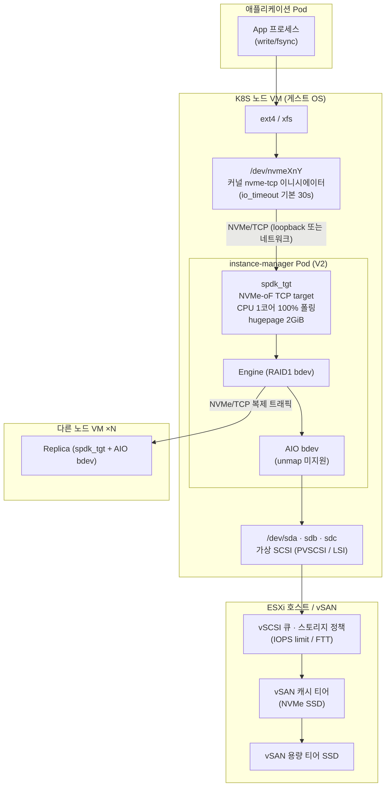
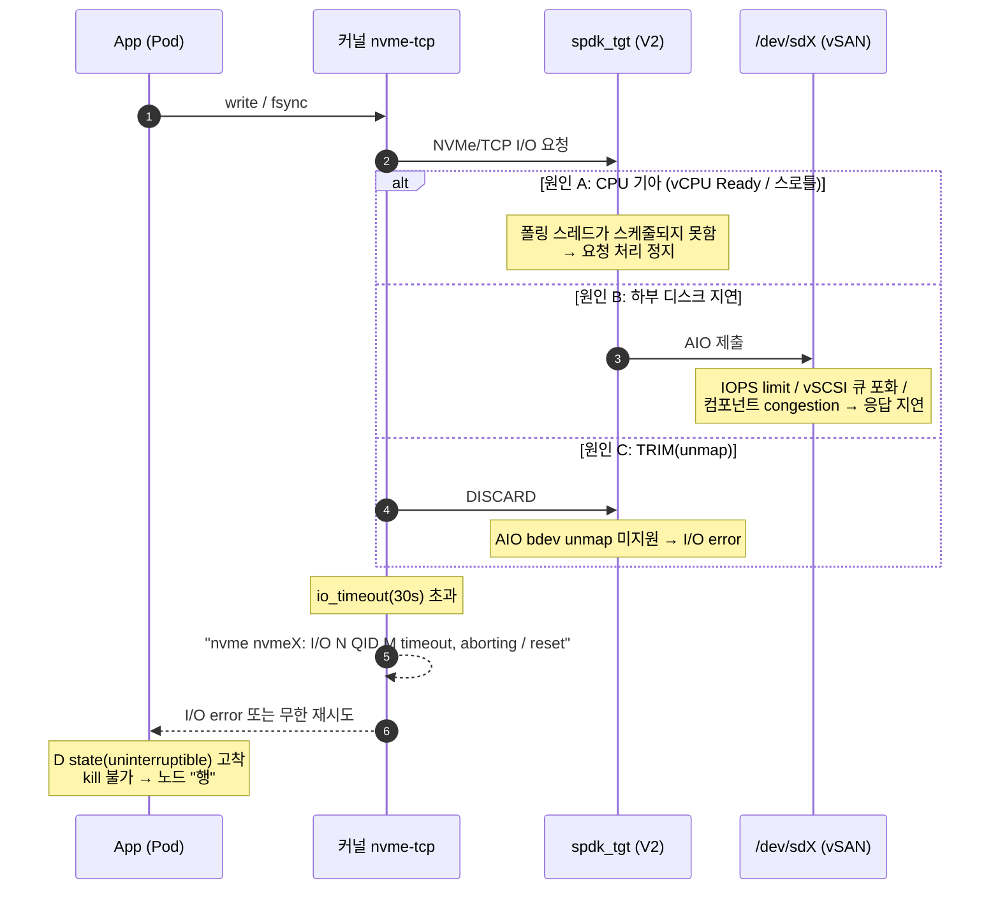
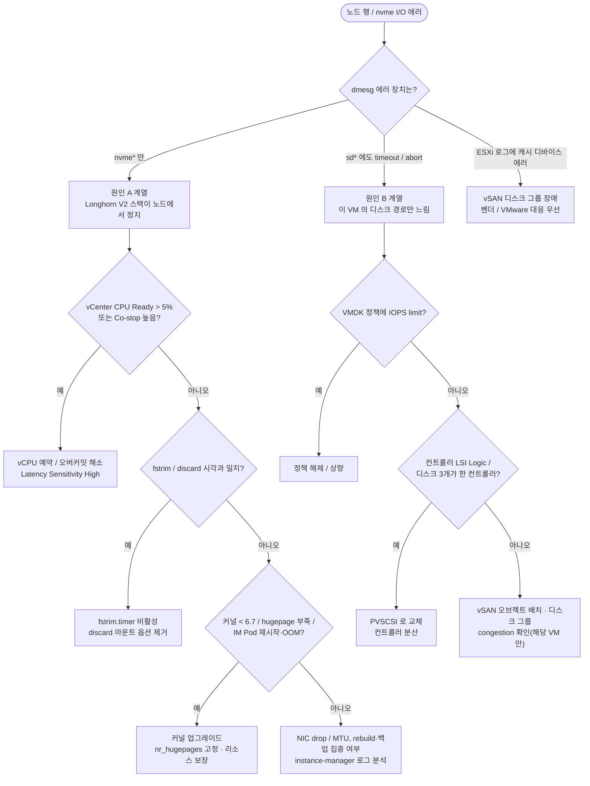
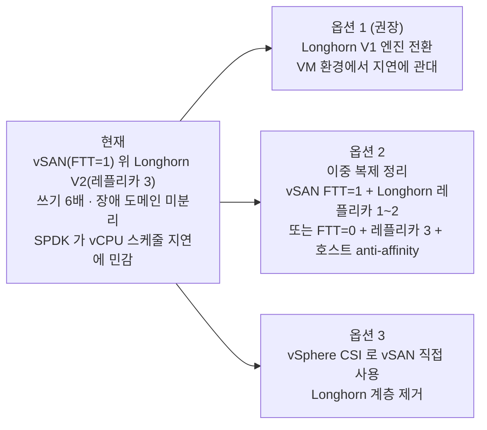

# Longhorn V2 on vSAN VM — `nvme` I/O 에러·행 걸림 원인 분석 / 해결 가이드

> 대상 환경: vSphere vSAN 위 VM 5대(K8S 노드) · 노드당 vSAN 가상 디스크 3개(`/dev/sda~c`, SCSI) ·
> Longhorn **V2 데이터 엔진(SPDK)** 블록 디스크로 등록.
> 증상: 특정 노드가 갑자기 행(D state 프로세스 누적), `dmesg` 에 `nvme ... I/O ... timeout` /
> `I/O error` 가 찍힘. 인프라 측 확인 결과 **같은 vSAN 의 다른 VM 에서는 에러 없음, 해당 노드만 발생.**

---

## 1. 결론 요약

1. **게스트 OS 에는 vSAN 캐시 티어 NVMe 가 보이지 않는다.** VM 에서 vSAN 디스크는 가상 SCSI(`sdX`)다.
   따라서 노드 `dmesg` 의 `nvme` 에러는 거의 확실히 **Longhorn V2 볼륨(`/dev/nvmeXnY`, NVMe-oF TCP)** 이다.
   "vSAN 캐시 NVMe 에러"가 아니라 **"Longhorn 볼륨 응답 없음"** 이고, 원인은 그 아래 계층에 있다.
   (예외: VM 디스크를 vNVMe 컨트롤러로 붙인 경우. `sda~c` 로 보이면 해당 없음.)
2. 다른 VM 이 정상이라면 vSAN 전체 장애가 아니라 **이 노드 고유의 원인**이다. 가장 유력한 원인은
   `spdk_tgt` 의 CPU 기아(vCPU Ready/스로틀)이고, 다음은 이 VM 디스크 경로만 느려지는 경우다
   (IOPS limit·vSCSI 큐·컴포넌트 편중). TRIM(unmap)·커널 버전·hugepage 도 함께 점검한다.
3. 근본적으로 **공유 스토리지(vSAN) 위에 분산 스토리지(Longhorn V2)를 다시 쌓은 구조**는 지연과 장애를
   증폭시킨다. VM 환경이라면 V1 엔진 전환이나 vSphere CSI 직접 사용을 검토한다(§7).

---

## 2. 동작 구조 — I/O 경로



핵심 포인트:

- 게스트의 `nvme*` 장치는 **Longhorn 이 만든 가상 NVMe-oF 디스크**다. 물리 NVMe 가 아니다.
- vSAN 캐시 NVMe 는 ESXi 안쪽(맨 아래 계층)에 있어 게스트에서는 보이지 않는다.
- 한 번의 쓰기는 `Longhorn 레플리카 수 × vSAN FTT 미러 수` 만큼 증폭된다(3 × 2 = 6 배).

---

## 3. 장애 전파 — 왜 "행"이 걸리나



---

## 4. 원인 판별 플로우



---

## 5. 진단 명령

### 5.1 게스트 노드 (행 걸린 노드)

```bash
# 어느 계층 에러인가: nvme = Longhorn 볼륨, sd = vSAN 가상 디스크
dmesg -T | egrep -i "sd[a-c]|scsi|abort|reset" | tail -50
dmesg -T | egrep -i "nvme|I/O error|blocked for more than" | tail -50

# D state 프로세스
ps -eo pid,stat,wchan:32,cmd | awk '$2 ~ /D/'

# NVMe-TCP 연결 상태 / timeout
nvme list-subsys
cat /sys/class/nvme/nvme*/state
cat /sys/module/nvme_core/parameters/io_timeout

# 기본 조건 (다른 4대와 비교)
uname -r
grep -i huge /proc/meminfo
lsmod | egrep "nvme_tcp|uio|vfio"
systemctl status fstrim.timer; journalctl -u fstrim --since "-2d"
mount | grep -i discard

# 네트워크 (복제 트래픽 경로)
ethtool -S <nic> | egrep -i "drop|err|discard"
ip link show <nic> | grep mtu
```

### 5.2 Longhorn

```bash
kubectl -n longhorn-system get volumes.longhorn.io,replicas.longhorn.io -o wide
kubectl -n longhorn-system get pod -o wide | grep instance-manager
kubectl -n longhorn-system describe pod <im-pod-on-this-node> | egrep -i "restart|oom|limit"
kubectl -n longhorn-system logs <im-pod-on-this-node> --since=2h | egrep -i "error|timeout|bdev|aio"
kubectl -n longhorn-system top pod | grep instance-manager
```

### 5.3 vSphere / ESXi (인프라 팀)

- 해당 VM: Performance → **CPU Ready %, Co-stop**, Virtual Disk latency (장애 시각 기준)
- 해당 VM VMDK 스토리지 정책: **IOPS limit**, FTT, 오브젝트 / 컴포넌트 배치
- 해당 VM 이 있는 호스트 / 디스크 그룹: vSAN Performance 의 backend latency, congestion, resync
- `vmkernel.log` · `vobd.log`: 장애 시각 전후의 `nvme`, `H:0x`, `APD`, `PDL`, `congestion`

---

## 6. 복구 절차

1. **하부 안정화 우선.** vSAN 측 이상이 있으면 그것부터 해결하고 resync 완료를 기다린다.
   하부가 불안정한 상태에서 Longhorn rebuild 를 돌리면 다시 실패한다.
2. **노드 정리.** D state 는 kill 로 풀리지 않는다. `kubectl cordon` 과 `drain` 을 시도하고, 안 되면 노드를 재부팅한다.
3. **볼륨 점검.** Degraded 볼륨은 healthy 레플리카 기준으로 rebuild 한다. Faulted 볼륨은 최신 레플리카에서
   salvage 한다. 작업 전에 가능하면 스냅샷과 백업을 확보한다.
4. **파일시스템 점검.** 마운트 전에 `fsck -n` 또는 `xfs_repair -n` 으로 확인한다.

---

## 7. 재발 방지

### 7.1 설정

| 항목 | 조치 |
|---|---|
| 디스크 경로 | Longhorn 노드 디스크를 `/dev/sdX` 대신 `/dev/disk/by-id/...` 또는 `by-path` 로 재등록 (재부팅 시 이름 뒤바뀜 방지) |
| TRIM | `systemctl disable --now fstrim.timer`, StorageClass·마운트 옵션에서 `discard` 제거 (AIO bdev unmap 미지원) |
| CPU | VM vCPU Reservation 또는 Latency Sensitivity High, 오버커밋 축소, instance-manager 코어 여유 확보 |
| 커널 | 6.7 이상 (nvme-tcp ↔ SPDK IO timeout 시 kernel panic·메모리 손상 이슈 회피) |
| hugepage | `vm.nr_hugepages=1024` (2 MiB × 1024 = 2 GiB) 를 `sysctl.d` 에 고정 |
| vSCSI | PVSCSI 컨트롤러 사용, 디스크 3개를 컨트롤러 여러 개로 분산 |
| 스토리지 정책 | Longhorn 노드 VMDK 에서 IOPS limit 해제 |
| NVMe timeout | 필요 시 `nvme_core.io_timeout` 상향 (증상 완화일 뿐 원인 해결 아님) |
| Longhorn | 최신 패치 버전으로 업그레이드 (V2 수정이 지속 반영됨) |

### 7.2 아키텍처



- V2 엔진은 **로컬 NVMe** 를 전제로 설계되었다. vSAN 위에서는 성능 이점이 거의 없고 지연 민감도만 커진다.
- V2 를 유지하려면 §7.1 의 CPU·커널·TRIM 항목을 반드시 적용하고, 레플리카와 FTT 조합을 재설계한다.

---

## 8. 에스컬레이션 시 수집할 자료

- 장애 시각 전후 ±10분의 `dmesg -T` (nvme · sd 양쪽)
- 해당 노드 instance-manager Pod 로그, `kubectl get volumes/replicas -o yaml`
- Longhorn support bundle (UI → Generate Support Bundle)
- vCenter: 해당 VM CPU Ready / Virtual Disk latency 차트, ESXi `vmkernel.log`
- 5대 노드의 `uname -r`, hugepage, VM 하드웨어(컨트롤러 종류·vCPU 예약) 비교표

---

## 참고

- Longhorn V2 Data Engine Prerequisites — https://longhorn.io/docs/1.11.3/v2-data-engine/prerequisites/
- Longhorn V2 data engine issues (burstable VM 에서 I/O stuck, #13585) — https://documentation.suse.com/en-us/cloudnative/storage/1.11/en/troubleshooting-maintenance/v2-data-engine-issues.html
- SUSE Virtualization — Longhorn V2 Data Engine (AIO bdev unmap 미지원) — https://documentation.suse.com/en-us/cloudnative/virtualization/v1.9/en/storage/longhorn-v2-data-engine.html
