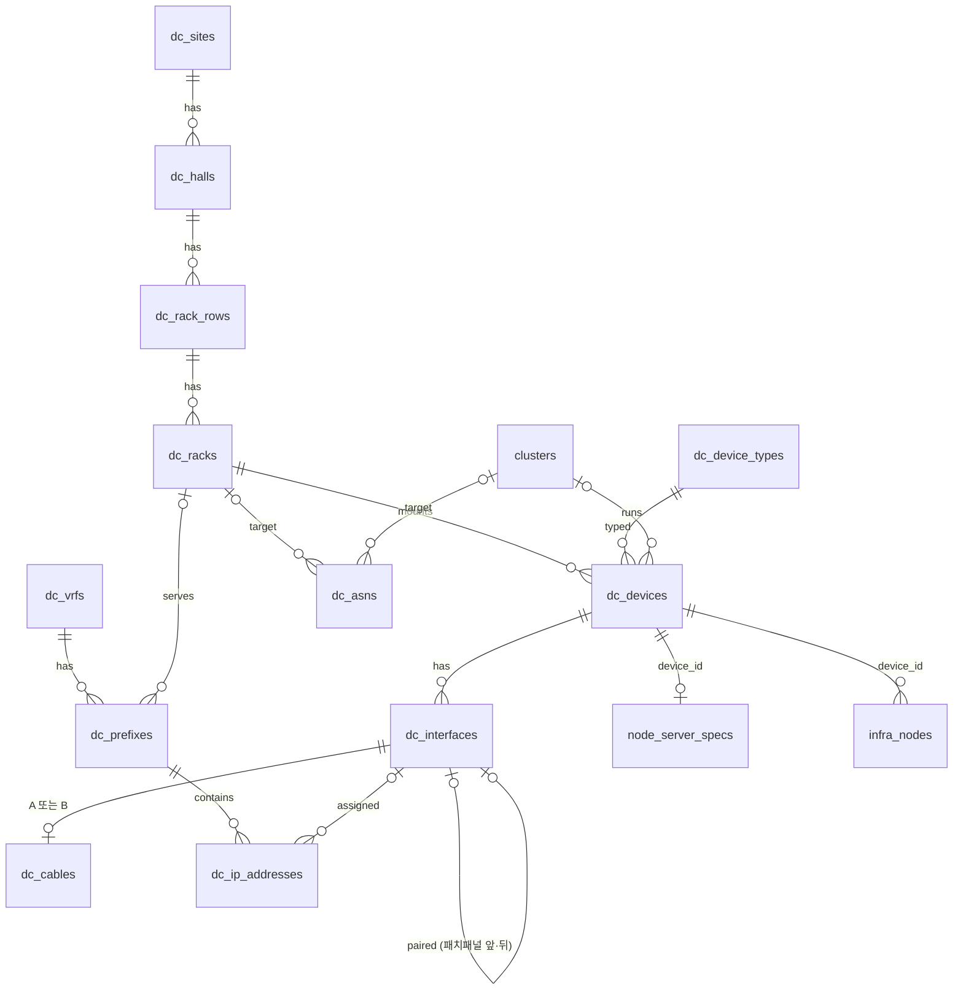

# DC 인벤토리 설계 (1단계 — 설계만)

> 상태: **검토 대기** · 작성 2026-11-16 · 코드 없음(이 문서와 화면 목업만)
> 화면 목업: https://claude.ai/artifact/HqZrVkUUaGxLhMrxfJ23MR (비공개 링크 — 작성자 계정에서만 열림, 다른 사람에게는 공유 설정 필요)
> 범위: 1개 DC · 랙 20~40 · 장비 400대 이하. NetBox 는 **개념과 화면 흐름만** 참고했고 코드·스키마·UI 는 가져오지 않는다.

## 0. 확정된 결정 (2026-11-16 사용자 확인)

| 결정 | 내용 |
|---|---|
| 서버 통합 | 신규 `dc_devices` 가 서버·스위치 **신원의 단일 원본**이다. 기존 `/node-specs`·`/infra-topology` 는 이 행에 연결되어 같은 값을 보여주고, 어느 화면에서 고쳐도 한 곳에 저장된다 (§2) |
| UI 편집 | 모든 엔티티(사이트~ASN, IPAM 규칙, 설정 템플릿)는 화면에서 생성·수정·삭제할 수 있다. Excel 일괄 등록은 보조 수단이다 |
| 목업·Excel | 기존 목업·샘플 Excel 이 없으므로 이 설계가 **Excel 양식(§5.3)과 화면 목업(§6)을 새로 정의**한다. 목업은 사용자 확인 후 3단계의 구현 기준이 된다 |

---

## 1. 기존 구조 분석과 끼울 위치

### 1.1 백엔드 (FastAPI)

| 항목 | 현재 방식 | DC 인벤토리 적용 |
|---|---|---|
| 모듈 구성 | `backend/app/{models,schemas,routers,services}/` — 라우터는 `routers/__init__.py` 에서 export, `main.py` 가 `/api/v1` 로 마운트 | `models/dc_inventory.py` · `schemas/dc_inventory.py` · `routers/dc_inventory.py`(prefix `/dc`) · `services/dc_inventory/` 패키지 |
| 인증·권한 | `main.py` 의 `_auth` dependency(JWT) + `auth/deps.py` `require_operator`/`require_admin` | 조회 = 로그인 사용자, 쓰기 = `require_operator`, IPAM 규칙·템플릿 편집 = `require_admin` |
| 화면 접근 제어 | `auth/feature_access.py` `FEATURE_API_PATTERNS` (라우트 경로 키 → API 패턴) | `"/dc-inventory": (r"^/dc(/|$)",)` 추가 |
| 테이블 생성 | `lifespan` 의 `Base.metadata.create_all` — 신규 테이블은 자동 생성. Alembic 없음 | 신규 테이블은 `models/__init__.py` 등록만으로 생성 |
| 기존 테이블 변경 | `_run_migrations()` 안에서 `_safe_add_column` / `_safe_exec` / `_safe_create_index` (실패해도 부팅 계속) | `node_server_specs.device_id`, `infra_nodes.device_id` 추가와 backfill 에만 사용 |
| 감사 | `services/audit_logger.record` — best-effort, 별도 커밋, before/after 없음 | 굵은 행위(일괄 등록 확정·설정 생성)만 병행 기록. 행 단위 이력은 전용 `dc_change_logs` |
| 설정 저장 | `AppSetting`(key → JSONB) | IPAM 규칙 오버라이드 `dc_inventory.ipam_rules` |
| 실시간 로그 | `services/sse.py` `stream_async_job` + 프론트 `postSse` | 일괄 등록 확정·LLDP 대조·설정 생성 |
| Excel | `openpyxl`(이미 의존) — `routers/jira.py` 의 `dry_run` 흐름, `routers/node_server_specs.py` `_compute_diffs`(preview → apply) | 같은 2단계 흐름을 재사용 |
| 낙관적 잠금 | `InfraNode.version` — 불일치 시 409 | 모든 `dc_*` 편집 대상에 `version` |
| 백업 | `services/backup_service.py` — per-table fault-tolerant, `LOG_TABLES`·`SENSITIVE_COLUMNS` | `dc_change_logs`·`dc_lldp_snapshots` 를 `LOG_TABLES` 에 등록. 민감 컬럼 없음(자격증명 미저장) |
| 클러스터 삭제 | `services/cluster_purge.py` 가 `cluster_id` 보유 테이블을 전수 탐색해 정책 적용 | `dc_devices`·`dc_asns` 는 **보존**하고 `cluster_id` 만 NULL(FK `SET NULL`) — 정책 목록에 등록 |
| 테스트 | `backend/tests/` pytest, DB 이름에 `test` 가 없으면 수집 전 중단 | `tests/test_dc_inventory_*.py` |

신규 백엔드 의존성: 2~5단계 **없음**. 6단계에 `Jinja2` 를 `requirements.txt` 에 명시 고정한다 — 이미 `ansible-core` 가 끌어오는
패키지지만 앱이 직접 import 하게 되므로 명시한다(추가 다운로드 없음, 사내 Nexus PyPI 프록시로 수급).

### 1.2 프론트엔드 (React + Vite)

| 항목 | 현재 방식 | DC 인벤토리 적용 |
|---|---|---|
| 라우팅 | `src/App.tsx` React Router v6, `RequireAdmin`·`RequireFeature` 가드 | `/dc-inventory` 및 하위 경로(§6) |
| 메뉴 | `components/layout/navConfig.ts` `NAV_MAP` + `GROUPS`, 라벨 키는 `i18n/resources/ko.ts` | leaf 1개 `/dc-inventory`("DC 인벤토리")를 `configure`(구성·자산) 그룹에 추가 |
| 서버 상태 | TanStack Query 훅(`hooks/`) + `services/api.ts`(axios, camel↔snake 자동 변환) | `dcApi` + `hooks/useDcInventory.ts` |
| 클라이언트 상태 | Zustand(`stores/`) — 서버 데이터와 섞지 않음 | 신규 store 없음. 선택한 열·필터는 URL 파라미터(`hooks/useUrlParams`) |
| 타입 | `src/types/index.ts` | `Dc*` 인터페이스 추가 |
| 레이아웃 | `common/PageShell`(밀도 3종) · `common/PageHeader` · `ui/MacCard` · `common/SegTabs` | 클러스터 단위 화면이 **아니므로 `ClusterSidebar` 없음**. `PageShell` 허브 밀도 |
| 실행 로그 | `common/RunLogPanel` + `hooks/useRunLog`·`useLogPref` ("로그 보기" 옵션) | 모든 "실행" 버튼에 적용(레포 필수 규칙) |
| 권한 UX | `useCanOperate()` — viewer 에게 숨기지 않고 `disabled` + 사유 | 추가·수정·삭제·확정 버튼 전부 |
| 재사용 컴포넌트 | `node-specs/DiffRow`, `common/ConfirmDialog`, `EmptyState`, `SearchableSelect`, `StatusBadge`, `SidePane` | 그대로 사용 |
| 디자인 토큰 | `src/index.css` — 테마 16종, raw hex·고정 팔레트 금지, 카테고리 색은 `--chart-*` 만 | 역할 색 = `--chart-*`(§6.2) |

신규 프론트 의존성: **없음**. 랙 배치도는 SVG 로 직접 그린다(동적 좌표를 SVG 속성으로 주므로 인라인 스타일 금지 규칙과 충돌하지 않는다).
웹폰트·CDN 호출 없음.

### 1.3 겹치는 기존 기능

| 기존 | 저장하는 것 | 문제 |
|---|---|---|
| `node_server_specs` (`/node-specs`) | 호스트명, 벤더·모델·시리얼, CPU/메모리/디스크, bond IP, `datacenter`·`room`·`rack`·`rack_unit`(문자열) | 랙·U 가 자유 문자열이라 검증·가시화 불가 |
| `infra_nodes` (`/infra-topology`) | 클러스터별 호스트명, `rack_name`, `switch_name`(문자열), 스펙 일부 | 같은 서버가 또 한 번 저장되고 서로 연결이 없다 |
| `management_servers` (Settings) | 점프 호스트 등 이름·host·SSH 포트 | 물리 위치 없음 |
| `/cidr` (CIDR 계산기) | 저장 없음(계산만) | IPAM 화면에서 링크로 연결 |

---

## 2. 서버 통합 설계 (단일 원본)

**원칙: 장비의 신원과 물리 위치는 `dc_devices` 한 곳에만 쓴다.** 다른 테이블은 그 행을 가리키고, 자기 영역의 정보만 가진다.

```
dc_devices            ← 신원: hostname · role · status · serial · 랙/U · cluster · k8s_node_name
  ▲ device_id            (서버 + 스위치 + 패치패널 전부)
  ├─ node_server_specs   ← 하드웨어 스펙·자산/계약 (서버만, 기존 컬럼 유지)
  └─ infra_nodes         ← K8s 관점 뷰 (auto_synced, 클러스터 내 역할)
```

### 2.1 연결과 값 일치

1. `node_server_specs.device_id`, `infra_nodes.device_id` (nullable UUID FK → `dc_devices.id`, `ON DELETE SET NULL`) 를 `_safe_add_column` 으로 추가한다.
2. **단일 쓰기 경로** `services/dc_inventory/device_registry.py`:
   - `upsert_device(hostname, **identity)` — 신원 항목을 `dc_devices` 에 쓰고 `dc_change_logs` 를 남긴다.
   - `mirror_to_linked(device)` — 연결된 행의 구 컬럼을 **같은 트랜잭션**에서 맞춘다. 구 컬럼은 지우지 않으므로 기존 API 응답 형태·CSV·백업은 그대로다.
3. 기존 라우터(`node_server_specs.py`·`infra_nodes.py`)의 생성·수정·CSV 적용·K8s 동기화는 겹치는 항목에 한해 이 서비스를 호출한다. 그 외 로직은 손대지 않는다.

| 원본 (`dc_devices`) | 미러 대상 |
|---|---|
| `hostname` | `node_server_specs.hostname`, `infra_nodes.hostname` |
| `serial` | `node_server_specs.serial_number` |
| `status` (`planned`·`active`·`spare`·`maintenance`·`decommission` — 기존 node-specs 값과 맞춤) | `node_server_specs.status` |
| `cluster_id`, `k8s_node_name` | `node_server_specs.cluster_id`·`node_name`, `infra_nodes.cluster_id` |
| 랙 이름 (`dc_racks.name`) | `node_server_specs.rack`, `infra_nodes.rack_name` |
| 시작 U + 높이 → `"U21-U22"` | `node_server_specs.rack_unit` |
| 사이트·홀 이름 | `node_server_specs.datacenter`·`room` |
| 케이블로 연결된 leaf 호스트명(파생값) | `infra_nodes.switch_name` (읽기 전용 파생) |

### 2.2 기존 데이터 연결 (backfill)

- 부팅 마이그레이션은 **컬럼 추가까지만** 한다. 데이터 연결은 자동으로 덮어쓰지 않고 화면에서 실행한다.
- `POST /dc/devices/link/preview` → 호스트명 기준 매칭 결과를 4종으로 분류: `연결 가능` / `장비 없음(생성 제안)` / `값 불일치(랙·시리얼이 서로 다름)` / `호스트명 중복(여러 클러스터에 같은 이름)`.
- `POST /dc/devices/link/apply` 는 사용자가 고른 행만 반영한다. 값 불일치는 행마다 어느 쪽 값을 쓸지 선택한다.
- 이후 기존 화면에서 새 서버가 등록되면(수동·K8s 동기화·CSV) `dc_devices` 행이 랙 미배정 상태로 함께 만들어진다 → 누락이 생기지 않는다.

### 2.3 다른 화면의 재사용

- 공용 조회 `GET /dc/devices/lookup?hostname=…|cluster_id=…` (가벼운 응답: id·hostname·role·랙·U·ToR).
- 프론트 공용: `hooks/useDcDevices.ts`, `components/dc-inventory/DevicePicker.tsx`(검색 선택), `DeviceLocationChip.tsx`("R07 · U21" 칩, 클릭 시 장비 상세).
- 3단계에서 `/node-specs`·`/infra-topology` 행에 위치 칩을 붙인다. `/bulk-exec`·`/node-ssh` 의 노드 목록 등 다른 화면은 같은 칩·피커를 필요할 때 가져다 쓴다(이번 범위 밖, 동작 변경 없음).

### 2.4 기존 동작 보존

- 기존 엔드포인트의 경로·요청·응답 스키마는 바꾸지 않는다(`device_id` 필드 추가만).
- `infra_nodes` 의 `(cluster_id, hostname)` 유일 제약은 그대로 둔다. `dc_devices.hostname` 은 전역 유일이므로 중복 호스트명은 연결 미리보기에서 사용자 판단으로 넘긴다.
- 통합 일치는 테스트로 고정한다: 세 화면 중 어디서 랙·시리얼·호스트명을 고쳐도 세 테이블 값이 같다(§7, 2단계 완료 기준).

---

## 3. 데이터 모델 (ERD)

공통: UUID PK, `version INTEGER NOT NULL DEFAULT 1`(낙관적 잠금), `created_at`·`updated_at`, 테이블 접두사 `dc_`.



### 3.1 위치 계층

| 테이블 | 필드 | 제약 |
|---|---|---|
| `dc_sites` | `name`, `description` | `name` 유일 |
| `dc_halls` | `site_id` FK, `name`, `description` | `(site_id, name)` 유일 |
| `dc_rack_rows` | `hall_id` FK, `name`(예: `A`), `sort_order` | `(hall_id, name)` 유일 |
| `dc_racks` | `row_id` FK, `name`(예: `R07`), `rack_no` INT(IPAM 규칙 입력값), `position_in_row` INT, `u_height` INT 기본 42, `power_note` TEXT, `status`(`active`·`planned`·`retired`), `description` | `name` **전역 유일**, `rack_no` 전역 유일(NULL 허용), `u_height` 1~60, 장비가 있으면 삭제 거부 |

상위 삭제는 하위가 있으면 409(연쇄 삭제하지 않는다).

### 3.2 장비

| 테이블 | 필드 | 제약 |
|---|---|---|
| `dc_device_types` | `vendor`, `model`, `u_height` INT, `is_full_depth` BOOL 기본 true, `default_role`, `interface_templates` JSONB(`[{name, speed_mbps, purpose}]`) | `model` 유일, `u_height` ≥ 0(0 = 랙 공간 미점유) |
| `dc_devices` | `hostname`, `role`(`server`·`leaf`·`spine`·`super-spine`·`mgmt`·`patch`), `device_type_id` FK, `rack_id` FK NULL, `position_u` INT NULL(가장 아래 U, 1 = 최하단), `face`(`front`·`rear`), `status`(`planned`·`active`·`spare`·`maintenance`·`decommission`), `serial`, `asset_tag`, `cluster_id` FK→`clusters` `SET NULL`, `k8s_node_name`, `description` | `hostname` 전역 유일, `serial` 유일(NULL 제외), `rack_id`·`position_u` 는 둘 다 있거나 둘 다 없음, `position_u + u_height − 1 ≤ rack.u_height`, **같은 랙에서 U 범위 겹침 금지** |
| `dc_interfaces` | `device_id` FK `CASCADE`, `name`(예: `eth0`·`Ethernet1/1`·`P01-front`), `speed_mbps` INT, `purpose`(`private-a`·`private-b`·`public-a`·`public-b`·`bmc`·`uplink`·`patch`·`other`), `mac`, `paired_interface_id` FK self NULL, `enabled` BOOL, `description` | `(device_id, name)` 유일, `paired_interface_id` 는 같은 장비의 다른 포트만, 케이블이 있으면 삭제 거부 |

장비 생성 시 `interface_templates` 로 인터페이스를 자동 생성한다(화면에서 끌 수 있음).

**패치패널**: `role = patch` 인 장비. 포트마다 앞·뒤 인터페이스 2개를 만들고 `paired_interface_id` 로 서로 묶는다. 경로 추적은 케이블 → (패치 포트면 짝 포트로 이동) → 케이블 순으로 따라간다.

### 3.3 케이블

| 테이블 | 필드 | 제약 |
|---|---|---|
| `dc_cables` | `a_interface_id` FK, `b_interface_id` FK, `label`, `status`(`planned`·`connected`·`faulty`), `cable_type`(`dac`·`aoc`·`fiber`·`utp`), `length_m`, `description` | `a_interface_id` UNIQUE, `b_interface_id` UNIQUE, CHECK `a ≠ b`, `label` 유일(NULL 제외), **인터페이스당 케이블 1개**(한 인터페이스가 A·B 어느 쪽에도 한 번만) |

### 3.4 IPAM

| 테이블 | 필드 | 제약 |
|---|---|---|
| `dc_vrfs` | `name`(`PUBLIC`·`PRIVATE` 기본 시드), `rd`, `description` | `name` 유일 |
| `dc_prefixes` | `vrf_id` FK, `cidr` (PG `CIDR`), `rack_id` FK NULL, `purpose`(`private-a`·`private-b`·`public-a`·`public-b`·`bmc`·`loopback`·`p2p`·`other`), `gateway` INET NULL, `description` | `(vrf_id, cidr)` 유일, **같은 VRF 안에서 Prefix 겹침 금지**(포함 관계 포함), `gateway` 는 `cidr` 안 |
| `dc_ip_addresses` | `prefix_id` FK, `address` (PG `INET`, 호스트 주소), `interface_id` FK NULL(`SET NULL`), `role`(`primary`·`vip`·`gateway`·`reserved`), `dns_name`, `description` | `(vrf_id, address)` 유일(`vrf_id` 는 prefix 에서 복제 저장), **`address` 는 `prefix.cidr` 범위 안**, 네트워크·브로드캐스트 주소 거부(/31·/32 예외) |
| `dc_asns` | `number` BIGINT, `target_type`(`rack`·`cluster`·`fabric_tier`), `rack_id` FK NULL, `cluster_id` FK NULL(`SET NULL`), `fabric_tier`(`leaf`·`spine`·`super-spine`) NULL, `description` | `number` 유일, 1 ~ 4294967295, `target_type` 에 맞는 대상 컬럼 하나만 채움(CHECK) |

### 3.5 변경 이력

| 테이블 | 필드 |
|---|---|
| `dc_change_logs` | `object_type`, `object_id`, `object_repr`(삭제 후에도 읽을 수 있는 이름 스냅샷), `action`(`create`·`update`·`delete`), `before` JSONB, `after` JSONB, `changed_fields` JSONB, `actor_user_id`, `actor_username`(스냅샷), `request_id`, `batch_id`(일괄 등록 1회 = 같은 값), `source`(`ui`·`import`·`link`·`sync`), `created_at` |

- 인덱스: `(object_type, object_id, created_at)`, `(batch_id)`, `(created_at)`.
- 데이터 변경과 **같은 트랜잭션**에서 쓴다 — 서비스 계층의 `changelog.record(db, obj, action, before)` 한 곳을 통해서만. 라우터가 ORM 을 직접 수정하지 않는다.
- `update` 는 바뀐 필드가 없으면 기록하지 않는다.

### 3.6 5·6단계 테이블

| 테이블 | 용도 |
|---|---|
| `dc_lldp_snapshots` | 업로드·수집된 LLDP 원본(JSONB), `device_id`, `collected_at`, `source`(`upload`·`ingest`) — 로그성 |
| `dc_lldp_reports` | 대조 1회 결과: 요약 건수 + 항목(`port_mismatch`·`no_signal`·`unknown_device`·`ok`) JSONB |
| `dc_config_templates` | 설정 템플릿의 UI 편집본(`kind`, `name`, `body`, `version`) — 레포 기본 템플릿을 덮어쓰는 오버라이드 |
| `dc_rendered_configs` | 생성본: `kind`, `rack_id`, `template_version`, `input_hash`, `content`, `created_by` — 이전 생성본과 diff 용 |

### 3.7 제약 구현 방법

| 제약 | 1차(서비스) | 2차(DB) |
|---|---|---|
| U 겹침 | 랙 행을 `SELECT … FOR UPDATE` 로 잠근 뒤 범위 교차 검사. 전체 깊이 장비는 앞·뒤 무관하게 충돌, 반깊이는 같은 면끼리만 충돌 | `EXCLUDE USING gist (rack_id WITH =, int4range(...) WITH &&)` — `btree_gist` 필요. `_safe_exec` 로 시도하고 실패해도 부팅은 계속(열린 질문 5) |
| 인터페이스당 케이블 1개 | A·B 양쪽 컬럼 교차 조회 | 컬럼별 UNIQUE + CHECK `a ≠ b` |
| IP ∈ Prefix | Python `ipaddress` 로 검증 | 트리거 없이 서비스 검증만(쓰기 경로가 한 곳) |
| Prefix 겹침 | 같은 VRF 의 기존 Prefix 와 `overlaps()` | `(vrf_id, cidr)` UNIQUE |
| 랙 이름·호스트명 유일 | 사전 조회로 한국어 사유 응답 | UNIQUE |

위반 응답: 값 형식 오류 422, 충돌 409 — `detail` 에 무엇과 겹치는지 적는다(예: `"R07 의 U21~U22 는 node-a-014 가 사용 중입니다"`).

---

## 4. 권한

| 동작 | 권한 |
|---|---|
| 조회·내보내기·경로 추적 | 로그인 사용자(viewer 포함) |
| 생성·수정·삭제·일괄 등록 확정·LLDP 업로드·설정 생성 | operator 이상 |
| IPAM 규칙·설정 템플릿 편집, 기존 데이터 연결 적용 | admin |
| LLDP ingest(수집 잡) | 전용 토큰 `DC_LLDP_INGEST_TOKEN` — 미설정 시 503(fail-closed, 기존 `SUPERPOD_INGEST_TOKEN` 과 같은 방식) |

DC 자산은 테넌트에 묶지 않는 전역 자산으로 둔다(열린 질문 7).

---

## 5. API (`/api/v1/dc`)

### 5.1 CRUD

모든 리소스가 같은 형태다: `GET /{res}`(필터·`limit`·`offset`), `POST /{res}`, `GET|PUT|DELETE /{res}/{id}`. `PUT` 은 `version` 을 받아 불일치 시 409.

| 리소스 | 경로 | 주요 필터 |
|---|---|---|
| 사이트·홀·열 | `/sites`, `/halls`, `/rack-rows` | `site_id`, `hall_id` |
| 랙 | `/racks` | `row_id`, `q` |
| 장비 종류 | `/device-types` | `q` |
| 장비 | `/devices` | `rack_id`, `role`, `status`, `cluster_id`, `unracked`, `q` |
| 인터페이스 | `/interfaces` | `device_id`, `purpose`, `connected` |
| 케이블 | `/cables` | `device_id`, `rack_id`, `status`, `q` |
| VRF·Prefix·IP·ASN | `/vrfs`, `/prefixes`, `/ip-addresses`, `/asns` | `vrf_id`, `rack_id`, `prefix_id`, `target_type` |

장비 생성 예:

```http
POST /api/v1/dc/devices
{
  "hostname": "node-a-014", "role": "server", "device_type_id": "6f0c…",
  "rack_id": "b21e…", "position_u": 21, "face": "front",
  "status": "active", "serial": "FAKE-SN-0014", "cluster_id": null,
  "create_interfaces_from_template": true
}
```
```json
201
{
  "id": "9a4d…", "hostname": "node-a-014", "role": "server",
  "device_type": {"id": "6f0c…", "model": "Server-2U", "u_height": 2},
  "rack": {"id": "b21e…", "name": "R07"}, "position_u": 21, "u_range": "U21-U22",
  "face": "front", "status": "active", "serial": "FAKE-SN-0014",
  "interface_count": 5, "version": 1
}
```
```json
409
{"detail": "R07 의 U21~U22 는 node-a-009 가 사용 중입니다", "code": "u_overlap",
 "conflict": {"device_id": "77c1…", "hostname": "node-a-009", "u_range": "U21-U22"}}
```

케이블 생성 예:

```http
POST /api/v1/dc/cables
{"a_interface_id": "e1…", "b_interface_id": "f2…", "label": "R07-014-PA", "status": "connected", "cable_type": "dac"}
```
```json
409
{"detail": "leaf-r07-a 의 Ethernet1/14 에는 이미 케이블 R07-009-PA 가 연결돼 있습니다", "code": "interface_in_use"}
```

IP 생성 예:

```json
422
{"detail": "10.10.8.5 는 Prefix 10.10.7.0/26 범위 밖입니다", "code": "ip_out_of_prefix"}
```

### 5.2 집계 조회 (화면용)

| 엔드포인트 | 응답 요약 | 쓰는 화면 |
|---|---|---|
| `GET /rack-rows/{id}/elevation` | 열의 랙 목록 + 랙별 장비(`id, hostname, role, status, position_u, u_height, face`)만. 인터페이스·케이블 제외 | 랙 열 뷰 |
| `GET /racks/{id}/summary` | 랙 + ToR(leaf) 장비 + Prefix + ASN + 서버 목록 + 사용 U/전체 U | 랙 상세 |
| `GET /devices/{id}/detail` | 장비 + 인터페이스(케이블 상대편·IP 포함) + 연결된 node-spec/infra-node id | 장비 상세 |
| `GET /interfaces/{id}/trace` | 경로 hop 배열 | 경로 추적 |
| `GET /devices/lookup` | 가벼운 장비 목록 | 다른 화면 재사용 |
| `GET /changes` | 변경 이력(`object_type`, `object_id`, `actor`, `batch_id`, 기간 필터, 키셋 커서) | 변경 이력 |
| `GET /overview` | 랙·장비·케이블·Prefix 건수, 미배정 장비 수, 연결 안 된 인터페이스 수 | 상단 요약 줄 |

`elevation` 응답 예(랙 20 · 장비 400 기준 약 60KB):

```json
{
  "row": {"id": "…", "name": "A", "hall": "Hall-1"},
  "racks": [
    {"id": "b21e…", "name": "R07", "rack_no": 7, "u_height": 42, "used_u": 38,
     "devices": [
       {"id": "9a4d…", "hostname": "node-a-014", "role": "server", "status": "active",
        "position_u": 21, "u_height": 2, "face": "front"},
       {"id": "c0…", "hostname": "leaf-r07-a", "role": "leaf", "status": "active",
        "position_u": 42, "u_height": 1, "face": "rear"}
     ]}
  ]
}
```

`trace` 응답 예:

```json
{
  "hops": [
    {"device": "node-a-014", "role": "server", "interface": "eth0", "rack": "R07"},
    {"cable": "R07-014-PA", "status": "connected"},
    {"device": "pp-r07-01", "role": "patch", "interface": "P14-front", "paired": "P14-rear"},
    {"cable": "R07-PP14-LA", "status": "connected"},
    {"device": "leaf-r07-a", "role": "leaf", "interface": "Ethernet1/14", "rack": "R07"}
  ],
  "uplinks": [
    {"from": "leaf-r07-a Ethernet1/49", "cable": "R07-LA-SP1", "to": "spine-01 Ethernet1/7"}
  ],
  "complete": true
}
```

종단이 leaf 면 그 leaf 의 `uplink` 인터페이스 경로를 `uplinks` 로 함께 준다(서버 → 패치 → leaf → spine).
케이블이 끊기면 `complete: false` 와 끊긴 지점을 돌려준다. 순환 방지를 위해 방문한 인터페이스를 기록하고 16 hop 에서 멈춘다.

### 5.3 일괄 등록 (Excel/CSV)

| 엔드포인트 | 설명 |
|---|---|
| `GET /import/template.xlsx` | 빈 양식(시트별 헤더 + 허용값 설명 시트) |
| `POST /import/preview` | multipart 파일 → 시트별 행 판정. DB 를 바꾸지 않는다 |
| `POST /import/apply` (SSE) | 같은 파일 + `sha256` + 적용할 시트 선택. **전체 단일 트랜잭션**, 오류가 하나라도 있으면 전부 롤백. 단계별 실시간 로그 |
| `GET /export.xlsx` | 현재 데이터를 같은 양식으로 내보내기(왕복 검증·백업용) |

**Excel 양식 (이 설계가 정의)** — 시트 이름과 열. 키 열(굵게)로 upsert 한다. CSV 는 시트 하나를 파일 하나로 올린다.

| 시트 | 열 |
|---|---|
| `racks` | **name**, site, hall, row, rack_no, position_in_row, u_height, power_note, status |
| `device_types` | **model**, vendor, u_height, is_full_depth, default_role |
| `devices` | **hostname**, role, device_type(model), rack, position_u, face, status, serial, asset_tag, cluster(이름), k8s_node_name, description |
| `interfaces` | **device**, **name**, speed(`25G` 등), purpose, mac, paired_with |
| `cables` | **label**, a_device, a_interface, b_device, b_interface, status, cable_type, length_m |
| `prefixes` | **vrf**, **cidr**, rack, purpose, gateway |
| `ip_addresses` | **vrf**, **address**, device, interface, role, dns_name |
| `asns` | **number**, target_type, rack, cluster, fabric_tier |

처리 순서: racks → device_types → devices → interfaces → cables → prefixes → ip_addresses → asns (참조 순서).
파일 안에서 새로 만드는 행을 뒤 시트가 참조할 수 있다. 검증은 §3 의 제약을 **파일 전체 + 기존 DB** 를 합쳐서 본다.

미리보기 응답 예:

```json
{
  "sha256": "5d1c…", "ok": false,
  "summary": {"insert": 412, "update": 8, "skip": 1580, "error": 3},
  "sheets": [
    {"name": "devices", "insert": 20, "update": 2, "skip": 378, "error": 1,
     "rows": [
       {"row": 37, "key": "node-a-014", "action": "update",
        "changes": {"position_u": {"old": 19, "new": 21}}},
       {"row": 58, "key": "node-a-035", "action": "error",
        "errors": [{"column": "position_u", "code": "u_overlap",
                    "message": "R07 의 U30~U31 은 같은 파일 41행 node-a-018 과 겹칩니다"}]}
     ]}
  ]
}
```

상한: 파일 10MB · 시트당 20,000행(초과 413). `skip` 행은 기본 접힘(응답에서 `include_skipped=false` 면 건수만).

### 5.4 IPAM 자동 제안 (4단계)

| 엔드포인트 | 설명 |
|---|---|
| `GET /ipam/rules` · `PUT /ipam/rules` | 규칙 조회·수정(admin). 응답에 `source: default|override` |
| `GET /ipam/suggest?rack_no=7` | 규칙을 적용한 Prefix·ASN 제안 + 항목별 충돌 여부. 저장하지 않는다 |
| `POST /ipam/apply-suggestion` | 사용자가 체크한 제안만 생성 |

규칙 기본값은 레포 파일 `backend/app/services/dc_inventory/ipam_rules.default.yaml`, 화면에서 고치면 `AppSetting dc_inventory.ipam_rules` 가 덮어쓴다(열린 질문 1).

```yaml
# 예시 값 — 실제 대역은 화면에서 설정한다
prefixes:
  - {vrf: PRIVATE, purpose: private-a, cidr: "10.10.{rack_no}.0/26"}
  - {vrf: PRIVATE, purpose: private-b, cidr: "10.10.{rack_no}.64/26"}
asns:
  - {target: rack, tier: leaf, number: "4200001000 + {rack_no}"}
```

산술은 `+ - *` 와 `{rack_no}` 만 허용하는 작은 파서로 계산한다(`eval` 금지).

```json
{
  "rack_no": 7,
  "prefixes": [
    {"vrf": "PRIVATE", "purpose": "private-a", "cidr": "10.10.7.0/26", "conflict": null},
    {"vrf": "PRIVATE", "purpose": "private-b", "cidr": "10.10.7.64/26",
     "conflict": {"code": "prefix_overlap", "with": "10.10.7.0/25 (R03)"}}
  ],
  "asns": [{"tier": "leaf", "number": 4200001007, "conflict": null}]
}
```

### 5.5 LLDP 대조 (5단계)

| 엔드포인트 | 설명 |
|---|---|
| `POST /lldp/snapshots` | JSON 파일 업로드(operator) |
| `POST /lldp/ingest` | 수집 잡용. `X-Ingest-Token` 검증, `_auth` 없이 마운트 |
| `POST /lldp/compare` (SSE) | 대상 장비 선택 → 최신 스냅샷과 `dc_cables` 비교 → 리포트 저장 |
| `GET /lldp/reports`, `GET /lldp/reports/{id}` | 리포트 목록·상세 |

수용 형식(정규화 형태 — 벤더 원본 변환은 열린 질문 9):

```json
{"device": "leaf-r07-a", "collected_at": "2026-11-16T02:00:00Z",
 "neighbors": [{"local_port": "Ethernet1/14", "remote_device": "node-a-014", "remote_port": "eth0"}]}
```

판정: `ok` / `port_mismatch`(상대 장비는 맞는데 포트가 다름, 또는 다른 장비) / `no_signal`(케이블은 등록돼 있는데 neighbor 없음) /
`unknown_device`(neighbor 가 인벤토리에 없음) / `unregistered_cable`(neighbor 는 있는데 케이블 미등록).
PEP 는 스위치에 **쓰지 않는다**. 리포트에서 케이블을 고치는 것은 사용자가 편집 화면으로 이동해 수행한다(자동 수정 없음).

### 5.6 설정 렌더링 (6단계)

| 엔드포인트 | 설명 |
|---|---|
| `GET /render/templates` · `GET|PUT /render/templates/{kind}` | 템플릿 목록·본문 조회·수정(admin). `source: default|override`, 기본값으로 되돌리기 |
| `POST /render/preview` | `{kind, rack_id}` → 렌더 결과(저장 안 함) + 입력 컨텍스트 |
| `POST /render/generate` (SSE) | 렌더 후 `dc_rendered_configs` 에 저장 |
| `GET /render/outputs?kind=&rack_id=` | 생성본 목록 |
| `GET /render/outputs/{id}/diff?against={id}` | unified diff(서버 `difflib`) |
| `GET /render/outputs/{id}/download` | 파일 다운로드 |

`kind`: `cilium-bgp-cluster-config` · `nxos-leaf-bgp` · `k8s-node-labels`(라벨 스크립트 **텍스트**만 생성).
Jinja2 `SandboxedEnvironment` + `StrictUndefined`. **적용 기능은 없다** — 결과는 사용자가 내려받아 GitOps 로 반영한다.

---

## 6. 화면

### 6.1 화면 목록과 이동

| 경로 | 화면 | 내용 |
|---|---|---|
| `/dc-inventory` | 랙 열 뷰 | 열 선택 → 랙 42U 배치도 가로 나열, 역할별 색, 범례, 검색(호스트명 강조). 빈 U 클릭 → 장비 추가 |
| `/dc-inventory/racks/:rackId` | 랙 상세 | 배치도(앞·뒤 전환) + ToR 2대 + 서브넷 + ASN + 서버 목록 |
| `/dc-inventory/devices/:deviceId` | 장비 상세 | 신원 + 인터페이스 표(케이블 상대편·IP) + 경로 추적 + 이 장비의 변경 이력 |
| `/dc-inventory/devices` | 장비 목록 | 필터 표, 미배정 장비, 기존 데이터 연결 |
| `/dc-inventory/cables` | 케이블 | 케이블 표(양 끝·라벨·상태) |
| `/dc-inventory/ipam` | IPAM | VRF 별 Prefix 표(사용률) · IP · ASN · 규칙(4단계) |
| `/dc-inventory/import` | 일괄 등록 | 양식 받기 → 올리기 → 미리보기 → 확정 |
| `/dc-inventory/changes` | 변경 이력 | 누가·언제·이전 → 이후 |
| `/dc-inventory/lldp` | LLDP 대조 | 업로드 → 대조 → 리포트(5단계) |
| `/dc-inventory/render` | 설정 생성 | 종류·랙 선택 → 미리보기 → diff → 다운로드(6단계) |

```
랙 열 뷰 ──(랙 제목)──▶ 랙 상세 ──(장비 행·배치도 칸)──▶ 장비 상세 ──(케이블 상대편)──▶ 다른 장비 상세
   │  └(빈 U)─▶ 장비 추가 폼              └(Prefix)─▶ IPAM                └(경로 추적 hop)─▶ 장비 상세
   └(상단 탭)─▶ 장비 · 케이블 · IPAM · 일괄 등록 · 변경 이력 · LLDP 대조 · 설정 생성
/node-specs · /infra-topology ──(위치 칩)──▶ 장비 상세 ──("서버 스펙 보기")──▶ /node-specs
```

상단 탭(`SegTabs`)은 모든 DC 인벤토리 화면에서 같다. 랙 상세·장비 상세는 탭 아래에 경로 표시(`A열 › R07 › node-a-014`).

### 6.2 표현 규칙

- 역할 색(범례와 배치도 공통, `--chart-*` 만): server `--chart-1` · leaf `--chart-2` · spine `--chart-4` · super-spine `--chart-5` · mgmt `--chart-3` · patch `--chart-8`.
  색만으로 구분하지 않도록 칸 안에 호스트명과 역할 약자를 함께 쓴다.
- 상태는 정상(`active`)이면 표시하지 않고, `planned`(점선 테두리)·`maintenance`·`decommission` 만 배지로 표시한다.
- 배치도는 SVG. U 번호는 아래가 1. 2U 이상 장비는 칸을 합쳐 그린다. 뒤면 장착 장비는 앞면 보기에서 빗금.
- 페이지 `<h1>` 은 `PageHeader` 하나, KPI 타일 행 없음(건수는 헤더 아래 한 줄 텍스트), 빈 상태는 `EmptyState`.
- 생성·수정은 모달 폼(`useModalA11y`), 삭제는 `ConfirmDialog`(danger). 표의 단순 값은 인라인 편집(`InlineTextCell`).
- **실행 버튼 = 실시간 로그**: 일괄 등록 확정·기존 데이터 연결·LLDP 대조·설정 생성은 `RunLogPanel` 에 단계 칩과 줄 단위 로그를 실시간으로 쌓고,
  "로그 보기" 옵션(`useLogPref`)으로 펼침 여부를 사용자가 정한다.
- viewer 는 버튼이 `disabled` + 사유 표시.

### 6.3 목업

검토용 목업(§문서 상단 링크) 5장이 위 화면과 1:1 로 대응한다: ① 랙 열 뷰 ② 랙 상세 ③ 장비 상세(경로 추적) ④ 장비 추가·수정 폼 ⑤ 일괄 등록 미리보기.
목업의 데이터는 전부 가짜 값이다. 승인된 목업이 3단계 구현 기준이며, 바뀌면 이 절과 `docs/SCREENS.md` 를 함께 고친다.

---

## 7. 단계별 구현 계획 (단계마다 PR 1개)

공통 완료 기준: `pytest -v` 통과 · `npm run lint && npx tsc --noEmit && npm run build` 통과 · `check_docs_sync.py`·`check_dialogs.py` 통과 ·
`CHANGELOG.md [Unreleased]` 갱신 · 기존 테스트 전부 통과(기존 기능 동작 불변).

### 2단계 — 모델 · CRUD API · 서버 통합 · 일괄 등록

- 범위: §3.1~3.5 모델, §5.1 CRUD, `device_registry`(§2), 기존 데이터 연결 API, §5.3 일괄 등록, 시드·검증 스크립트. 화면은 일괄 등록과 최소 목록만.
- 주요 파일: `models/dc_inventory.py`, `schemas/dc_inventory.py`, `routers/dc_inventory.py`, `services/dc_inventory/{validation,changelog,device_registry,importer,exporter}.py`,
  `main.py`(`device_id` 컬럼 2개·라우터 마운트), `backup_service.py`(`LOG_TABLES`), `cluster_purge.py`, `feature_access.py`,
  `scripts/lab/seed_dc_inventory.py`, `scripts/dc_inventory/verify_import.py`, 프론트 `DcInventoryImportPage.tsx`.
- 테스트: U 겹침·케이블 중복·Prefix 밖 IP·이름 중복 거부, 낙관적 잠금 409, 변경 이력 before/after, 일괄 등록 전체 롤백, 통합 미러(세 테이블 값 일치), 권한(viewer 쓰기 403).
- 완료 기준:
  - 같은 U 중복 배치 · Prefix 밖 IP · 케이블 중복 연결이 API 에서 409/422 로 거부된다.
  - 시드(랙 20 · 장비 400 · 케이블 1,600)를 export → 빈 DB 에 import → 다시 export 한 결과가 `verify_import.py` 로 **행 단위 일치**.
  - `/node-specs` 에서 랙을 고치면 `dc_devices`·`infra_nodes` 가 같은 값이 되고 그 반대도 성립한다.

### 3단계 — 화면

- 범위: 랙 열 뷰, 랙 상세, 장비 상세(경로 추적), 장비·케이블 목록, 변경 이력, 전 엔티티 생성·수정 폼, `/node-specs`·`/infra-topology` 위치 칩.
- 주요 파일: `pages/DcInventory*.tsx`, `components/dc-inventory/{RackElevation,RackRowView,DeviceForm,CableForm,TracePath,DevicePicker,DeviceLocationChip}.tsx`,
  `hooks/useDcInventory.ts`, `App.tsx`, `navConfig.ts`, `i18n/resources/ko.ts`, `docs/SCREENS.md`, `CODE_MAP.md`.
- 완료 기준:
  - 시드 데이터에서 랙 열 뷰가 **1초 안에 렌더**(측정: Playwright 로 탐색 시작 → 마지막 랙 SVG 표시까지, 로컬 compose 기준 3회 중앙값. `elevation` API 는 쿼리 2회·200ms 이내).
  - 모든 엔티티를 화면에서 만들고 고치고 지울 수 있다. 목업 5장과 구성이 일치한다.
  - 서버 → 패치 → leaf → spine 경로가 화면에 표시된다. 테마 16종에서 raw 색 없음, axe 스캔 serious 0.

### 4단계 — IPAM 자동 제안

- 범위: §5.4, IPAM 화면의 규칙 탭, 랙 추가 폼의 "제안 받기".
- 완료 기준: 랙 번호 입력 시 규칙대로 Prefix·ASN 이 제안되고 충돌이 표시된다. 규칙을 화면에서 바꾸면 제안이 바뀐다. 규칙 파서가 허용 외 수식을 거부한다.

### 5단계 — LLDP 대조

- 범위: §5.5, LLDP 대조 화면, `DC_LLDP_INGEST_TOKEN`(`docs/ENVIRONMENT.md`·`.env.example`).
- 완료 기준: 시드 케이블에서 일부를 바꾼 LLDP JSON 을 올리면 `포트 다름 / 신호 없음 / 미등록 장비` 가 정확히 분류된다. 토큰 미설정 시 ingest 503. 스위치로 나가는 쓰기 호출이 코드에 없다.

### 6단계 — 설정 렌더링

- 범위: §5.6, 설정 생성 화면, 기본 템플릿 3종, `Jinja2` 명시.
- 완료 기준: 랙 단위로 3종이 생성되고 미리보기 · 이전 생성본 diff · 다운로드가 된다. 같은 입력이면 같은 출력(golden 파일 테스트). 템플릿의 정의되지 않은 변수는 오류로 표시된다. 적용 엔드포인트가 없다.

### 전체 완료 기준 매핑

| 기준 | 검증 위치 |
|---|---|
| 랙 20 · 장비 400 · 케이블 1,600 시드로 랙 열 뷰 1초 | 3단계 Playwright 측정 |
| U 중복 · Prefix 밖 IP · 케이블 중복 거부 | 2단계 pytest |
| Excel import 결과가 원본과 행 단위 일치 | 2단계 `scripts/dc_inventory/verify_import.py` |
| 단계마다 pytest · 프론트 빌드 통과 | 각 PR 의 CI |

시드 데이터는 전부 가짜 값이다: 호스트명 `node-a-001` 형식, 시리얼 `FAKE-SN-*`, PRIVATE 는 예시 규칙 대역, PUBLIC 은 문서·벤치마크용 대역(`198.18.0.0/15`), ASN 은 사설 4바이트 대역.

---

## 8. 하지 않는 것

- 스위치·K8s 에 대한 쓰기(설정 push, 라벨 직접 변경). 생성물은 텍스트 파일까지다.
- 자격증명 저장. LLDP 는 업로드 또는 토큰 ingest 로만 받는다.
- 실제 IP·자격증명을 코드나 시드에 넣는 것.
- 기존 화면·API 의 동작 변경(`device_id` 필드 추가와 값 출처 통합 외).
- 외부 CDN·외부 API 호출, 신규 프론트 라이브러리.
- 다중 DC·전력/냉각 계산·케이블 트레이 경로·VLAN 관리(범위 밖 — 필요해지면 별도 설계).

---

## 9. 열린 질문 (결정 필요)

| # | 질문 | 선택지 | 추천 |
|---|---|---|---|
| 1 | IPAM 규칙·설정 템플릿의 원본 위치 — "설정 파일/레포 관리" 요구와 "UI 에서 수정" 요구가 겹친다 | (a) 레포 파일만 (b) 레포 기본값 + 화면 오버라이드(DB) (c) DB 만 | **(b)** — 기본값은 레포에서 리뷰하고, 현장 값은 화면에서 고치며 변경 이력을 남긴다. 화면에 "기본값과 다름" 표시 |
| 2 | 기본 템플릿 폴더 | (a) 레포 루트 `templates/` (b) `backend/app/templates/dc_inventory/` | **(b)** — backend 이미지 빌드 컨텍스트 안이라 폐쇄망 이미지에 그대로 들어간다 |
| 3 | `management_servers`(점프 호스트 등)도 `dc_devices` 로 통합할지 | (a) 이번엔 제외 (b) `device_id` 연결만 (c) 완전 통합 | **(b)** 를 3단계 이후에 — SSH 접속 정보는 그대로 두고 위치만 연결 |
| 4 | 기존 데이터 연결 시 값이 다를 때 기본 선택 | (a) node-specs 값 (b) infra-nodes 값 (c) 기본값 없이 행마다 선택 | **(a)** 를 기본 선택으로 보여주되 행마다 바꿀 수 있게 |
| 5 | 운영 PostgreSQL 에 `btree_gist` 확장을 만들 수 있는지 | (a) 가능 → DB 제약 이중화 (b) 불가 → 서비스 검증만 | 가능하면 **(a)**. 불가여도 동작은 같다 |
| 6 | 반깊이 장비가 같은 U 의 앞·뒤를 나눠 쓰는 것을 허용할지 | (a) 허용 (b) 금지(U 당 장비 1대) | **(a)** — 패치패널·mgmt 스위치가 뒤면에 들어가는 경우가 흔하다 |
| 7 | DC 인벤토리를 테넌트 격리 대상으로 할지 | (a) 전역 자산 (b) 테넌트별 | **(a)** — 물리 자산은 플랫폼 팀 공용. 역할 권한으로만 제어 |
| 8 | 변경 이력 보존 기간 | (a) 무기한 (b) 기간 후 정리(`log_retention_service`) | **(a)** — 400대 규모에서는 양이 작고 이력이 자산 대장의 일부다. 백업에서는 로그 옵션으로 제외 가능 |
| 9 | LLDP 수집 주체와 입력 형식 | (a) 외부 수집기가 정규화 JSON 을 ingest (b) PEP 배치잡이 SSH 로 `show lldp neighbors` 수집(읽기 전용) | **(a)** 로 시작 — PEP 가 스위치 자격증명을 갖지 않는다. 스위치 벤더·OS 와 원본 JSON 샘플이 필요하다 |
| 10 | 삭제 정책 | (a) 실제 삭제 + 변경 이력 (b) 상태 `decommission` 만 | 장비는 **(b) 우선 + (a) 는 admin**, 케이블·IP 는 (a) |
| 11 | 랙 밖 장비(spine·super-spine)와 "패브릭 계층" ASN 의 표현 | (a) 네트워크 랙도 일반 랙으로 등록 (b) 랙 없는 장비로 등록 | **(a)** — 열 뷰에 같이 보인다. ASN 대상 `fabric_tier` 는 계층 공통 ASN 일 때만 사용 |
| 12 | 일괄 등록 방식 | (a) upsert(없는 행은 그대로 둠) (b) 파일에 없는 행 삭제까지(전체 대체) | **(a)** — 삭제는 화면에서만. (b) 는 미리보기에 "파일에 없는 행" 을 참고로만 표시 |
| 13 | 메뉴 위치 | (a) 구성·자산 (b) 토폴로지 | **(a)** — 등록·관리 화면이다. `/infra-topology` 에서 링크로 연결 |
| 14 | `node_server_specs` 의 bond IP·BMC IP 를 IPAM 주소와 연결할지 | (a) 이번엔 따로 둠 (b) 4단계에서 인터페이스 IP 로 미러 | **(b)** — 통합 원칙상 IP 도 한 곳에 있어야 하지만 2단계 범위를 키우지 않는다 |
| 15 | 현재 Excel 의 실제 시트·열 구조 | — | §5.3 양식과 다르면 열 이름 매핑을 추가한다. 실제 파일의 헤더 행만 공유해 주면 반영 |
